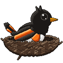
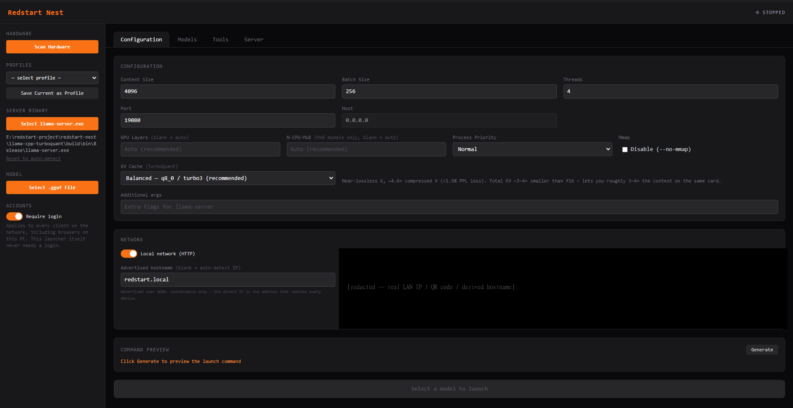
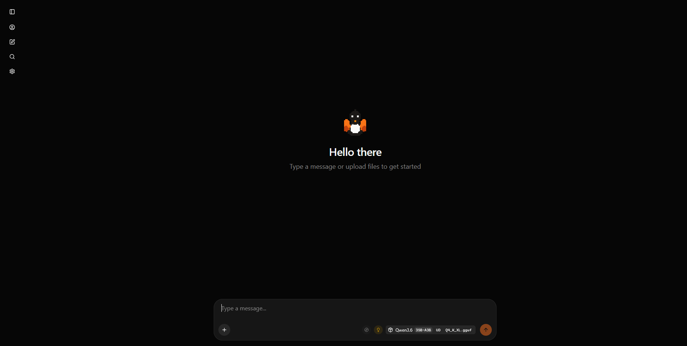
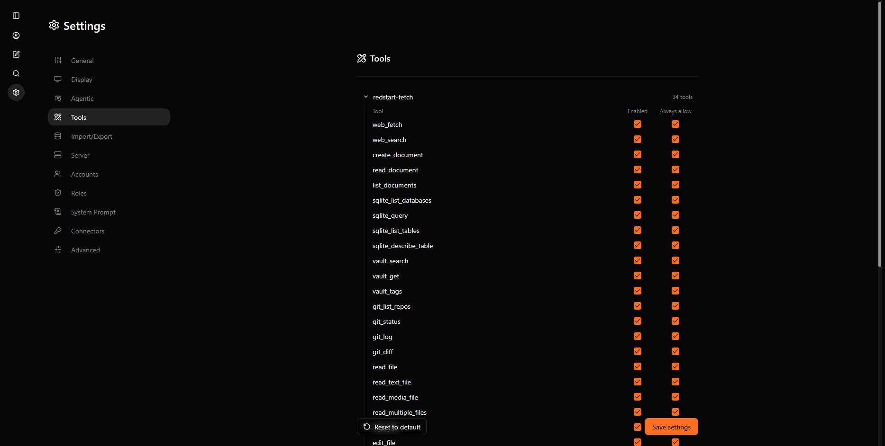

<p align="center">
  
</p>

# Redstart

**A self-hosted AI server for a household or small office.** Redstart Nest runs a local model with llama.cpp on a Windows PC with a GPU. Other devices on the network can then use it from a browser, a desktop app, or any OpenAI-compatible tool. Nest handles accounts, controls which tools the model can use, and reports exactly what can leave the machine.

> **Alpha software** (`1.0.0-alpha.N`). It's built and tested on one Windows machine. Don't run it anywhere data loss or an exposed service would matter.

**Docs:** [Mission](docs/mission.md) · [Architecture](docs/architecture.md) · [Security](docs/security.md) · [Capabilities](docs/capabilities.md) · [Configuration](docs/configuration.md) · [Development](docs/development.md) · [Roadmap & limitations](docs/roadmap.md)

| Nest launcher | Chat UI | Tool settings |
|---|---|---|
|  |  |  |

---

## What's in it

**Redstart Nest** (the server, a Tauri desktop app with a headless Node daemon):

- **Runs the model.** It manages llama-server: model files, a Hugging Face browser, GPU offload, and start and stop. The server keeps running from the tray when the window is closed.
- **Serves the network.** The chat UI is served by Nest, so any browser works. A LAN beacon lets Twig find the server automatically, and a QR code opens the chat UI on a phone.
- **Has accounts.** There are Owner, Admin and User roles. Login is required by default, with no localhost exemption. Each account's files are kept separate from everyone else's.
- **Controls the tools.** There's a built-in MCP server. Every capability is off by default and is enabled per profile, and a role can withhold tools:
  - Web fetch from approved sources. General web search is optional, through SearXNG or Brave.
  - Read-only Postgres and SQLite
  - A markdown vault and Git repositories
  - Documents (read, and create docx, pdf and md)
  - A file system
  - Sandboxed Python (Pyodide, no network)
  - Document search
  - Per-account memory
  - Scholar (OpenAlex, arXiv, PubMed)
  - Third-party MCP plugins
- **Reports egress.** Nothing about a conversation leaves the machine unless an admin enabled it. `GET /egress` lists what can leave right now.
- **Keeps admin separate.** The admin panel is on its own port with its own login, and it's on loopback unless you move it. Signing in to chat doesn't give anyone control of the server.
- **Updates itself.** Updates are checked against a signing key built into the app.

**The chat UI** is forked from llama.cpp's web UI and shared by every client. It adds projects, workflows (saved prompts), memory, file uploads and a file browser.

**Redstart Twig** is a lightweight desktop client (Tauri) that finds Nest on the LAN. It can also give the model access to a folder on your own machine. The Android build is out of date and doesn't work right now; use a phone browser instead.

**Other OpenAI-compatible clients** such as Kilo Code, Continue and Aider connect to `http://<nest-ip>:19080/v1` with an account's `rst_` API key.

## How it fits together

```
GPU PC — Redstart Nest                      Other devices
 ├─ Gateway       :19080  (LAN when network mode is on)  ◄── browser, Twig, coding agents
 ├─ llama-server  :19081  (always loopback)
 ├─ MCP server    :19082  (built-in tools + plugins)
 ├─ Admin plane   :19083  (launcher UI, Owner only, loopback by default)
 └─ Beacon        :8765   (LAN discovery)
```

Network mode is a socket bind, not a firewall rule. With it off, the gateway and MCP server listen only on `127.0.0.1`. **Don't expose the gateway to the public internet.** Details: [Architecture](docs/architecture.md) · [Security](docs/security.md).

---

## Install

**Requirements:** Windows 10/11 and a GPU with 6 GB+ VRAM (NVIDIA recommended; CUDA or Vulkan). You also need a GGUF model; [unsloth](https://huggingface.co/unsloth) and [bartowski](https://huggingface.co/bartowski) on Hugging Face are good sources.

1. Download `Redstart-Nest-Setup-1.0.0-alpha.N.exe` from [Releases](../../releases) and run it. It's unsigned, so SmartScreen will warn you: choose **More info → Run anyway**.
2. On first launch, enter the machine's **setup code** (filled in automatically on the host; also in `bootstrap-token.txt` in Nest's config folder) and create the Owner account. The setup code is a recovery credential, kept in plain text deliberately, like the sticker on a router.
3. Pick a `.gguf` model and click **Start Server**. The chat UI is at `http://127.0.0.1:19080`.
4. To reach it from other devices, turn on **Configuration → Network → Local network**, then create accounts for each person. That panel shows the address and a QR code.

Closing the window doesn't stop the server. Use **Shut down** in the launcher, or **Quit Redstart** in the tray. Remote admin is a separate switch in the same panel (`http://<nest-ip>:19083`, Owner only).

**Twig for Windows:** install `Redstart Twig Setup 1.0.0-alpha.N.exe` from Releases. It finds the server on its own.

**macOS:** releases include Apple Silicon `.dmg` builds of both apps, but they've never been run on a Mac and aren't notarized.

## Tested configuration

| | |
|---|---|
| Hardware | Ryzen 7 7700X, RTX 3060 12 GB, 32 GB DDR5 |
| Model | [Qwen3.6-35B-A3B-UD-Q3_K_XL](https://huggingface.co/unsloth/Qwen3.6-35B-A3B-GGUF) (MoE, ~3B active parameters) |
| Speed | ~25–45 tokens/sec with llama-server's `--fit` auto-offload |

This is the only hardware it has been run on.

## Known limitations

The main ones; the [full list is in the roadmap](docs/roadmap.md#known-limitations).

- **Windows-only server in practice.** The daemon runs under plain Node, and there are macOS builds and a draft `deploy/` (systemd, Windows service, Caddy), but none of those has been run on real hardware.
- **Twig for Android is broken.** It's paused, not abandoned.
- **Unsigned installers.** Expect SmartScreen and Gatekeeper warnings.
- **One model at a time.** The active profile applies to every account.
- **Shared capabilities are all-or-nothing.** Vault, Git, SQLite and Postgres are shared by every account; per-account grants are the next planned work.
- **HTTP only on the LAN.** For TLS, put Caddy in front (`deploy/Caddyfile`).
- **Large Windows installer.** The bundled CUDA 12.4 build carries kernels for every NVIDIA architecture. RTX 50-series cards are untested.

---

## How it compares

- **LM Studio, Jan, Ollama** run models on the PC in front of you. If that's all you need, use one of them; they're more mature. Redstart is for the next step: one GPU box serving several people and devices.
- **Open WebUI, LibreChat, AnythingLLM** already offer multi-user chat with accounts, document chat and tools over any OpenAI-compatible backend. They're far more mature and run on any OS, so they're often the better choice. Redstart differs in a few specific ways:
  - It runs and manages the model itself.
  - It's a Windows desktop app with zero-configuration LAN discovery and QR connect, not a Docker deployment.
  - It treats egress as something to report and lock down: tools are off by default, only explicitly allowed requests leave the machine, and `GET /egress` gives the live answer.
  - The admin plane is separate from chat.
  - Each client app gets its own key, so the server knows which app is calling.

## Development

```bash
cd redstart-nest
npm install
npm install --prefix src/chat-ui   # the chat UI is its own package
node scripts/stage-node.mjs        # the pinned Node 26 the daemon runs on
npm run dev                        # launcher + chat UI + Tauri shell (needs Rust)
npm run daemon                     # or: the daemon alone, headless
npm run test:security              # the security and contract suites (also run in CI)
```

Repo layout, builds and the llama-server binary: [Development](docs/development.md).

The same server is the backend for two sibling projects in separate repos, both in progress: [Blueprints](https://github.com/ImDeadWeight/redstart-blueprints) (a SQL workbench) and [Yellowscript](https://github.com/ImDeadWeight/redstart-yellowscript) (a VS Code coding agent).

---

## Acknowledgements

[llama.cpp](https://github.com/ggerganov/llama.cpp) is the inference engine, and its web UI is the base of the chat frontend. [TurboQuant](https://github.com/TheTom/llama-cpp-turboquant) is the source of the bundled `llama-server.exe`. [Unsloth](https://huggingface.co/unsloth) supplied the quantized model used in development.

## About

Built by Patrick Carswell as a first major software project. It started from wanting a local AI on home hardware, and from a social-work background where client information shouldn't leave the room. I designed the product and architecture and made the technical decisions. Claude Code was my pair programmer for implementation, debugging and code generation.

MIT licensed. See [LICENSE.txt](redstart-nest/LICENSE.txt).
