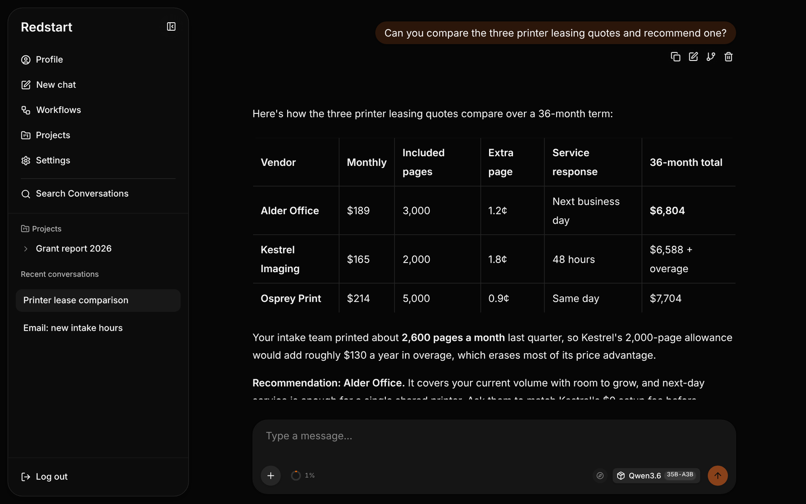
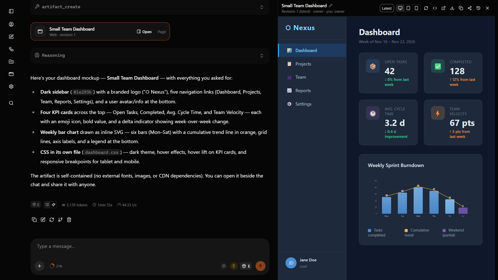
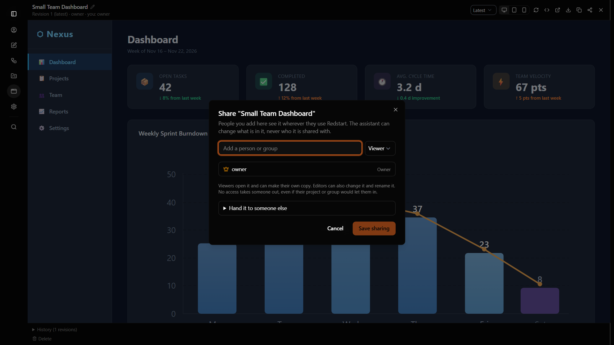
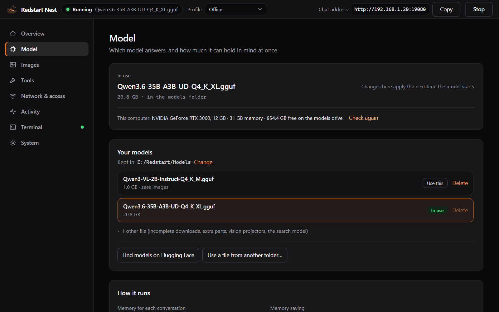
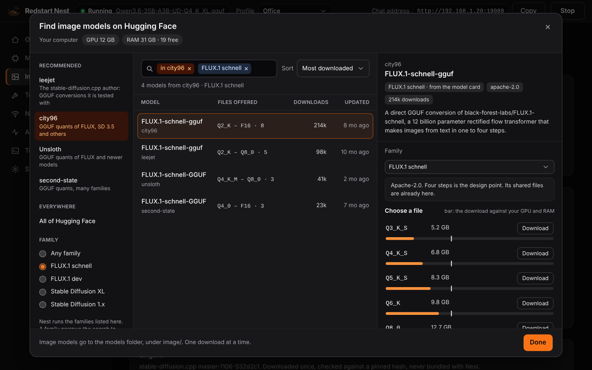
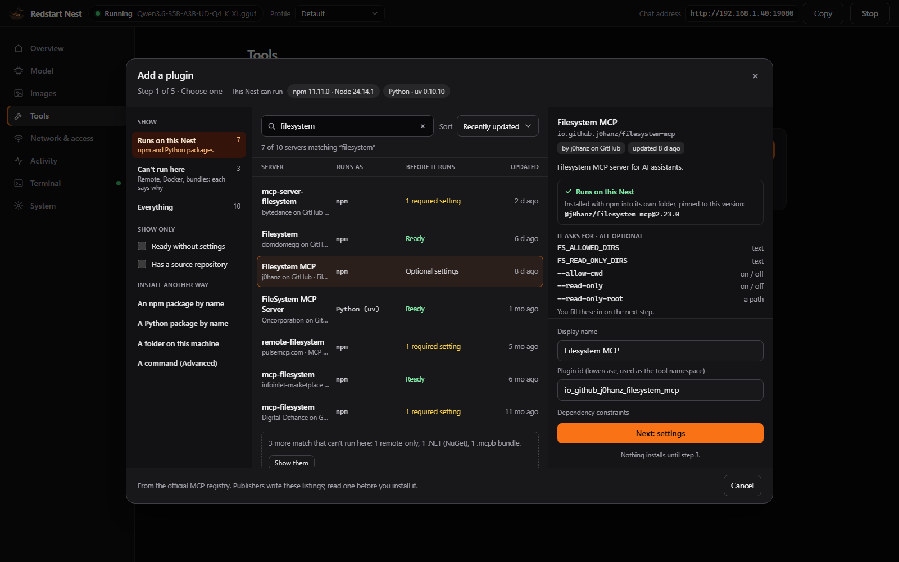
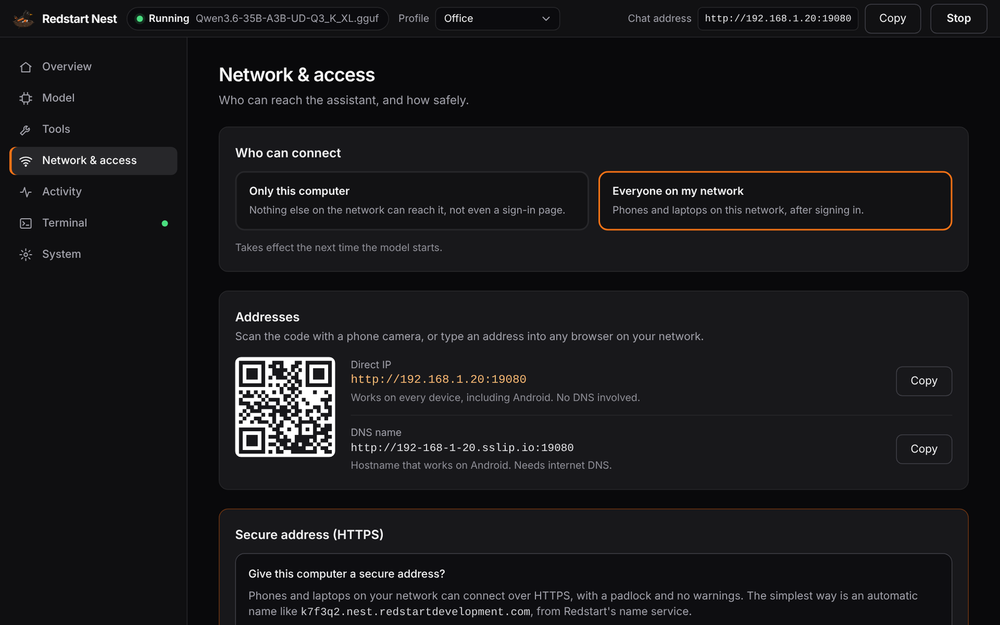
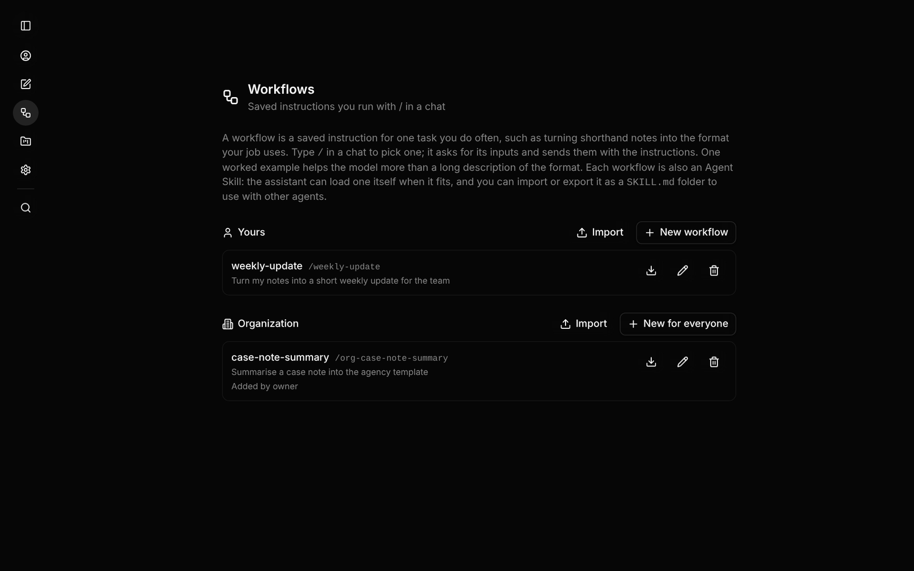
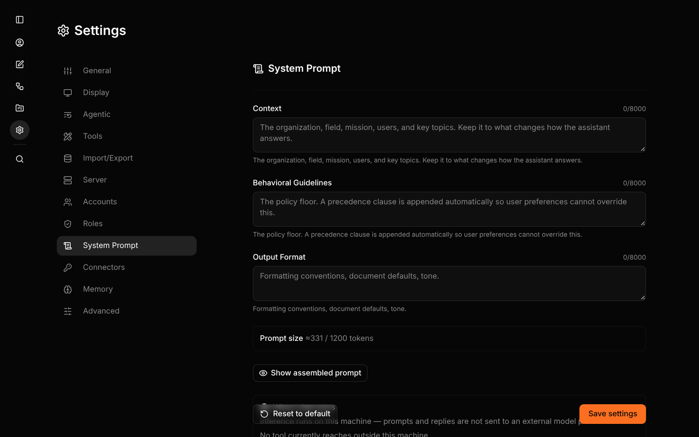

 <p align="center">
  
</p>

# Redstart

**Local AI server infrastructure.**

Redstart is an open-source platform for building a shared, network-accessible AI environment around locally hosted models.

At its center is **Redstart Nest**, a server that manages local model inference through [llama.cpp](https://github.com/ggml-org/llama.cpp) and provides the surrounding infrastructure needed to make that inference available to applications and users across a network.

Nest manages the inference server and adds an application-facing gateway, account and access management, tool integrations, server administration and optional AI services around it. It also includes an evolving agent runtime for coordinating more complex tasks.

Applications can connect to Nest through its network interfaces, using it as a shared local AI provider without each application needing to manage its own model server.

Redstart includes its own clients and applications, but its broader purpose is to provide infrastructure that other applications and workflows can use as well.

**Documentation:** [Mission](docs/mission.md) · [Architecture](docs/architecture.md) · [Security](docs/security.md) · [Capabilities](docs/capabilities.md) · [Configuration](docs/configuration.md) · [Development](docs/development.md) · [Deployment](deploy/README.md) · [Roadmap](docs/roadmap.md)

---

> **AI Assistance Disclosure**
>
> This project was developed using Claude Code as an AI pair programmer. I designed the product, architecture, user experience and technical direction, while using Claude to accelerate implementation, debugging and code generation. All design decisions and final technical choices were made by me.

---

## Screenshots

<p align="center">
  
</p>

**The chat** — served by Nest to any browser on your network, or through Redstart Twig.

<a href="docs/screenshots/chat-conversation.png"></a>

**Pictures, made on your GPU** — the model can call `generate_image`. Nest pauses the chat model, starts the separate image-generation engine, and brings the chat model back when the image is ready.

<a href="docs/screenshots/chat-image.png"></a>

**Artifacts** — ask for a page, a prototype or a mockup and the model builds it as an artifact that opens beside the chat. Every change is kept as a revision you can go back to, and it runs in a sandbox on its own address, so its scripts can't reach your login or the server.

<a href="docs/screenshots/chat-artifact.png"></a>

<details>
<summary><b>Sharing an artifact</b></summary>
<br>

<a href="docs/screenshots/artifact-share.png"></a>

</details>

**Redstart Nest** — the administration interface for managing the server, model configuration, tools and network access.

<a href="docs/screenshots/nest-overview.png"></a>

<details>
<summary><b>More of Redstart Nest</b> — Model, Images, Tools, Plugins, Network &amp; access, Terminal</summary>
<br>

**Model** — model selection, hardware information and memory settings, with llama.cpp flags under Advanced.

<a href="docs/screenshots/nest-model.png"></a>

**Finding a model** — browse supported publishers on Hugging Face, inspect model files and compare their sizes against available GPU memory and RAM before downloading.

<a href="docs/screenshots/nest-hf-models.png"></a>

**Images** — configure the separate image-generation model and its engine.

<a href="docs/screenshots/nest-images.png"></a>

**Finding image models** — browse supported image-model families and their shared files.

<a href="docs/screenshots/nest-hf-images.png"></a>

**Tools** — configure the capabilities available to connected applications.

<a href="docs/screenshots/nest-tools.png"></a>

**Adding a plugin** — browse the official MCP registry for servers that run on your Nest. Each result shows what it installs and what settings it needs before you install it.

<a href="docs/screenshots/nest-plugins.png"></a>

**Network &amp; access** — manage connection settings, addresses, QR codes, HTTPS and sign-in.

<a href="docs/screenshots/nest-network.png"></a>

**Terminal** — live output from the underlying model server.

<a href="docs/screenshots/nest-terminal.png"></a>
</details>

<details>
<summary><b>More of the chat</b> — on a phone, Accounts, Roles, Workflows, System prompt</summary>
<br>

**On a phone** — the same chat interface, with no app required.

<p align="center"><a href="docs/screenshots/chat-phone.png"></a></p>

**Accounts** — each person signs in with their own account, with separate files and conversation history.

<a href="docs/screenshots/chat-accounts.png"></a>

**Roles** — control which capabilities and resources an account can access.

<a href="docs/screenshots/chat-roles.png"></a>

**Workflows** — saved instructions for recurring tasks, personal or shared.

<a href="docs/screenshots/chat-workflows.png"></a>

**System prompt** — shared organizational context, behavioral guidelines and output formatting composed by the server for connected clients.

<a href="docs/screenshots/chat-system-prompt.png"></a>
</details>

<sub>All captured from this repository's own code. The Nest pages and image-generation example are from a real run on the tested hardware below: Qwen3.6-35B-A3B answering, FLUX.1 schnell drawing, with the network address replaced by a stand-in. Other chat screens were captured against a stand-in model server, so those answers are scripted.</sub>

---

## What Nest does

**Redstart Nest is the server infrastructure around the model server.** It manages the underlying inference process and provides the services that make it usable by multiple people and applications: network access, accounts, tool policy, administration and discovery.

The underlying inference is performed by `llama-server`, part of llama.cpp. Nest manages that process and provides an application-facing gateway rather than implementing its own inference engine.

- **Manages the model server.** Nest handles model files, configuration, GPU settings and the llama-server lifecycle. The inference process runs on the host machine and listens on loopback.
- **Makes the service available across a network.** Nest's gateway provides the network-facing entry point. Its beacon allows compatible clients to discover the server, and a QR code opens the browser chat interface from another device.
- **Provides accounts and roles.** Login is enabled by default, roles are assigned per account, and account files are structurally isolated.
- **Applies tool policy centrally.** Capabilities and plugins are configured on the server. Per-connector credentials identify the application connecting to Nest, allowing policy to be applied by application surface.
- **Separates administration from chat.** The admin plane has its own port, authentication and lifecycle. Chat access does not grant process-control permissions.
- **Can provide HTTPS on the LAN.** Nest can use its bundled Caddy integration to serve the chat interface with a real certificate through a Redstart-managed name or a supported external domain configuration. This is optional and off by default.
- **Makes external access explicit.** Inference is local, while configured tools and integrations may contact external services. Nest provides an egress report showing what is permitted.

### Redstart Twig

Redstart Twig is the companion chat client. It discovers Nest on the local network and connects without requiring users to enter a hostname or configure an API endpoint.

The Windows desktop version works. The macOS build has not yet been tested on a Mac. The Android build is out of date and currently not working; a phone browser using Nest's built-in chat interface is the working alternative.

Since llama-server provides an OpenAI-compatible API, other compatible applications can also connect to Nest without Redstart-specific code.

---

## What the assistant can do

The chat interface includes an agent runtime that can use configured tools, work with local data and coordinate multi-step tasks. These capabilities are implemented by Redstart and its integrations, not supplied automatically by llama.cpp.

The runtime is actively developed. Its performance and reliability vary by model, particularly with smaller local models. The benchmark results below and in the documentation are intended to make that performance measurable rather than assumed.

Every capability except artifacts is disabled until an administrator enables it; artifacts are on by default and can be switched off per profile. Roles can withhold capabilities from accounts or narrow access to shared resources.

**Work with your data** ([Capabilities](docs/capabilities.md))

- **Files and documents.** Read PDFs, Word, Excel, CSV and Markdown files; create `.docx`, `.pdf` and `.md` files that appear in the chat as downloads. Each account's files are its own.
- **Run Python.** `run_python` runs numpy, pandas and matplotlib in a WebAssembly sandbox with no network and no access outside the conversation's own folder. Charts come back as images.
- **See images.** With a supported vision model, the assistant can inspect photos and screenshots attached to a conversation and image files accessed through `view_image`.
- **Make pictures.** `generate_image` uses a separately configured image model through stable-diffusion.cpp. Nest coordinates the process transition between the chat model and image model. On a 12 GB GPU, the chat model pauses while the image is generated and resumes afterward; other chats wait rather than fail.
- **Make pages, prototypes and mockups.** The assistant builds web pages, interactive prototypes, document mockups and SVGs as artifacts that open beside the chat, then edits them in place when asked. Every revision is kept and can be restored. Artifacts are shared like projects, and only people can share or delete them, never the assistant. They run in a sandbox on their own address and can't load anything from outside. Yellowscript works on the same artifacts with the same tools.
- **Search your own files with citations.** Hybrid word and embedding search over uploads, attachments and created documents, with numbered sources linked back to each file. An administrator can add a Shared Documents folder for read-only organizational reference material.
- **Query databases and repositories, read-only.** Postgres and SQLite, Markdown notes and local Git repositories.
- **Reach the web, where allowed.** Fetch from approved sources, search the web and look up academic papers through OpenAlex, arXiv and PubMed.
- **Add more integrations.** Install third-party MCP servers as plugins. Their tools are subject to Nest's configured policies.

**Work like an agent**

- **Ask instead of guessing.** When a task depends on information only the user can provide, the assistant can ask questions through a structured clarification interface.
- **Plan longer work.** Multi-step tasks can be represented as checklists in the chat.
- **Ask before changing things.** Writes and deletes can require approval through a server-checked approval flow. Deletions go to the Recycle Bin.
- **Continue after the page closes.** Chats run on the server by default, so refreshing a page or closing a browser does not end the response. `/task` can hand longer work to the server. Tasks can survive a restart and wait for user input or approval.
- **Retrieve tools as needed.** Capabilities marked catalog-only can be discovered through `search_tools`, using a local embedding model to rank relevant tools. This keeps large tool catalogs from crowding a model's context.

**Remember what matters** ([Memory](docs/security.md#memory))

- **Three kinds of memory:** facts about the user, working preferences and guidance, and the current state of ongoing work.
- **Automatic suggestions with user control.** After a conversation goes quiet, the system can suggest information worth retaining. Suggestions include the source text they came from. The default mode waits for approval; automatic saving is also available with Undo.
- **Explicit memory commands.** `/remember` can save a specific item. Settings → Memory provides controls for reviewing and managing saved information.

**Organise the work**

- **Projects** group chats with their own instructions, files and memories. Project instructions can import from and export to `AGENTS.md`.
- **Workflows** are saved instructions for recurring tasks, personal or shared across an organization. They can be run with `/` and stored as Agent Skills (`SKILL.md`).
- **Slash commands** provide shortcuts for common actions, including `/new`, `/model`, `/mode`, `/project`, `/compact`, `/task`, `/remember`, `/memory`, `/retry`, `/copy`, `/rename`, `/export` and `/help`.

**Measured, not assumed.** The repository includes an agent benchmark and a memory benchmark, including tests for prompt-injection attempts. Results are recorded against specific models so changes to the runtime can be evaluated.

---

## How it works

```text
[ GPU PC ]                              [ Phone / Laptop / VS Code / Browser ]

  Redstart Nest                            Redstart Twig / compatible clients
  ├─ Gateway     :19080 (network entry)    ├─ Scans LAN on port 8765
  │   └─ Applies Redstart context/policy   ├─ Finds Nest automatically
  ├─ llama-server :19081 (localhost)       └─ Connects through Nest gateway
  ├─ MCP server   :19082
  ├─ Admin plane  :19083 (owner-only,
  │                  loopback by default)
  └─ Beacon       :8765
```

The roles of these components are distinct:

- **llama-server** performs model inference and provides the underlying inference API.
- **Nest's gateway** is the application-facing entry point. It authenticates requests, applies Redstart-specific context and tool policies, and forwards inference requests to llama-server.
- **Nest's MCP server** exposes configured tools and integrations to compatible clients.
- **The admin plane** provides server administration separately from chat access.
- **The beacon** allows compatible clients to discover Nest on the local network.

The chat UI is reachable in a browser at `http://127.0.0.1:19080`, and at the Nest machine's LAN address when network access is enabled.

**Two planes, two lifetimes.** The gateway, inference server and MCP server are tied to the model-serving lifecycle. The admin plane stays available when the model is stopped, because the interface used to control the server must be able to start it. It authenticates separately from the chat interface and listens on loopback unless deliberately exposed.

Details: [Architecture](docs/architecture.md) · [Capabilities](docs/capabilities.md) · [Security](docs/security.md)

---

## Control, not isolation

Inference is local: llama-server runs on the host machine and is bound to loopback. Conversation content is not transmitted anywhere by default.

However, local inference does not mean every operation is necessarily isolated from the internet. Nest can be configured to reach approved web domains, academic search services, external tool servers or plugins that use external credentials.

Those connections are administrator-controlled. The server's `GET /egress` endpoint reports which domains are approved, which tool servers are remote and which local stores are configured.

The honest one-line version is **local inference with administrator-controlled egress**.

Accounts are enabled by default, with no localhost exemption, and account files are structurally isolated. **Do not expose the gateway port directly to the public internet.**

See [Security → What actually leaves the machine](docs/security.md#what-actually-leaves-the-machine).

---

## Requirements

**Redstart Nest (server)**

- Windows 10/11 (the currently supported server platform).
- A GPU with at least 6 GB VRAM. NVIDIA is recommended; llama.cpp supports CUDA and Vulkan.
- A GGUF model file.
- For image generation, a supported image model. FLUX.1 schnell Q4_K and its shared files require approximately 10 GB of storage and peak near 11 GB of VRAM while generating, with the chat model paused.

**Redstart Twig (desktop)**

- Windows 10/11.
- macOS on Apple Silicon is experimental and not yet fully tested.

**Redstart Twig (Android)**

- Android 10 or later, on the same Wi-Fi network as Nest.
- The current Android build is out of date and not working. Use a phone browser in the meantime.

---

## Installation

> **Alpha software.** Releases are published as prereleases and versioned `1.0.0-alpha.N`. Expect rough edges. Do not run this where losing data or exposing a service would matter.

### Redstart Nest

1. Download the latest `Redstart-Nest-Setup-1.0.0-alpha.N.exe` from [Releases](../../releases).
2. Run the installer. Windows Defender may warn about an unsigned binary.
3. Open Redstart Nest. The setup screen asks for this machine's setup code and the Owner credential you want to create. On the host itself, the code is filled in for you. It is also stored in `bootstrap-token.txt` in Nest's configuration folder.
4. Select a `.gguf` model file and click **Start Server**.
5. In **Network & access**, choose **Everyone on my network** to make the server reachable from other devices. Create accounts for the people who will use it. The same panel shows the addresses and QR code for connecting from a phone.

The setup code is a recovery credential intended for someone with physical access to the host. It can be used to re-key the Owner account if the password is lost, which signs out existing sessions. Protect access to the host and its configuration directory accordingly.

**Closing the window does not stop the server.** Nest continues running in the tray so the model remains available to other devices. Reopening the window reconnects to the running daemon. To stop the server, use **Shut down** in the launcher or **Quit Redstart** in the tray menu.

**Remote administration is off by default.** The Network & access page has a separate setting for exposing the admin interface. This is separate from enabling chat access because allowing people to use the model and allowing them to control the server are different decisions.

### Redstart Twig (Windows)

1. Download the latest `Redstart-Twig-Setup-1.0.0-alpha.N.exe` from [Releases](../../releases).
2. Install and open the app. It scans the local network for Nest automatically.

Twig updates itself by downloading new releases in the background and installing them when the application closes.

### Redstart Twig (Android)

> **Currently out of date and not working.** The Android client has fallen behind recent Nest changes and should not be relied on.
>
> In the meantime, use a phone browser. Browse to `http://<nest-ip>:19080` or scan the QR code in **Network & access** to open the chat interface without installing an app.

### macOS (experimental)

Releases also include `.dmg` installers for Apple Silicon. Nest has been run on an Apple Silicon MacBook, but testing is incomplete. Twig has not yet been tested on a Mac. Treat both builds as experimental.

The applications are not notarized, so macOS may block the first launch. Additional platform-specific behavior and known testing gaps are documented in the [Mac testing notes](#mac-testing-so-far).

#### Mac testing so far

The first hands-on test found several issues involving hardware reporting, model selection, application icons and network discovery. Fixes have been made in code but are waiting for another hands-on Mac test.

Not yet tested on a Mac: model loading and inference using Metal, image generation, network mode and HTTPS, automatic updates, and Twig.

---

## Using Nest as a coding agent provider

Since the underlying llama-server provides an OpenAI-compatible API, coding extensions and other compatible applications can use Nest as their model provider.

For example, with **Kilo Code**:

1. Open VS Code and navigate to Kilo Code settings.
2. Set **API Provider** to `OpenAI Compatible`.
3. Set **Base URL** to `http://127.0.0.1:19080/v1`, or use the Nest machine's LAN IP when connecting from another device.
4. Set **API Key** to the account's `rst_` API key when login is enabled.
5. Set **Model** to the name of the loaded model.

The same general approach applies to [Continue](https://continue.dev/), [Aider](https://aider.chat/) and other applications that accept a custom OpenAI-compatible endpoint.

These applications use Nest for inference access. They continue to provide their own agent runtimes, tools and workflows unless they implement a deeper Redstart integration.

---

## Tested configuration

The following hardware and models were used during development. Results vary with GPU, quantization, context size and task type. The models have not been benchmarked on macOS, Linux, AMD GPUs or Apple GPUs.

| Component | Configuration |
|---|---|
| CPU | AMD Ryzen 7 7700X |
| GPU | NVIDIA RTX 3060 12 GB |
| RAM | 32 GB DDR5 |
| OS | Windows |
| Inference engine | Upstream llama.cpp, managed by Nest |

| Model | Quantization | Measured |
|---|---|---|
| [Qwen3.6-35B-A3B](https://huggingface.co/unsloth/Qwen3.6-35B-A3B-GGUF) | `UD-Q3_K_XL` | 41–45 tokens/sec writing a five-page report, with llama-server's `--fit` and **Disable memory-mapping** enabled. Best early agent-benchmark result: 21/24 tasks. |
| Ornith 1.5 9B | `Q6_K` | Approximately 40 tokens/sec alone, 35–36 tokens/sec with two requests at once; up to 128k context on the 12 GB card. Runtime tuning has used this model extensively: 76–81% on the 32-task agent benchmark. |
| [Qwen3-4B-Instruct-2507](https://huggingface.co/unsloth/Qwen3-4B-Instruct-2507-GGUF) | `UD-Q4_K_XL` | 58–67% on an earlier 24-task agent benchmark. |

The benchmark tasks, model-specific findings and instructions for running the tests are in [Models tested](docs/model-testing.md).

**About the 35B model:** Qwen3.6-35B-A3B is a mixture-of-experts model with approximately 3B active parameters. It can run at useful speeds on a 12 GB GPU because not all of its parameters are active for each token.

It does not fit entirely in 12 GB of VRAM. llama-server's `--fit` can place some tensors in system RAM, and the **Disable memory-mapping** setting can help when expert tensors are placed on the CPU. Performance depends on the hardware and configuration.

**About quantization:** The `UD` prefix refers to Unsloth Dynamic quantization, which applies different quantization levels to different layers rather than using one uniform bit depth.

**Finding models:** [Hugging Face](https://huggingface.co) is a common source for GGUF models. Nest's Model page can search and download from supported publishers including [Unsloth](https://huggingface.co/unsloth) and [bartowski](https://huggingface.co/bartowski).

---

## Known limitations

Redstart is still alpha software. Some important limitations are:

- **Twig for Android is out of date and not working.** Use the browser chat interface instead.
- **Unsigned installers.** Windows installers can trigger SmartScreen warnings. macOS builds are not notarized.
- **Windows is the only supported server platform.** macOS testing has started, but remains incomplete. Linux deployment artifacts have not been tested on real hardware.
- **Deployment artifacts are an early draft.** The systemd, Windows service and Caddy deployment configurations have been written and reviewed, but not fully executed in production environments.
- **HTTPS is optional and relatively new.** Without it, LAN traffic, including passwords, is plain HTTP. HTTPS has not yet been validated across a wide range of home networks.
- **External MCP servers requiring API keys or OAuth have limitations.** Saved API keys are currently used for Nest's connection test, and OAuth is not supported in the chat integration.
- **mDNS / `redstart.local` has been retired.** Use the IP address or QR code instead. Twig's beacon discovery does not depend on `.local` resolution.
- **Postgres access is all-or-nothing.** Unlike some other resources, a role cannot currently restrict a Postgres connection to selected folders or schemas.

The [Roadmap](docs/roadmap.md#known-limitations) contains the broader list of known limitations and planned work.

---

## Development

```bash
cd redstart-nest
npm install
npm install --prefix ../chat-ui   # the chat-ui is its own package
node ../tooling/stage-node.mjs     # the pinned Node 26 the daemon runs on
npm run dev                        # Vite + chat-ui + the Tauri shell (needs Rust)
```

To run the server without the desktop shell:

```bash
npm run daemon          # boots the daemon under plain Node
npm run daemon:status
npm run daemon:stop
```

Full setup, repository layout, test commands and installer builds: [Development](docs/development.md). Running Nest as a service: [Deployment](deploy/README.md).

---

## Alternatives worth knowing about

If your goal is simply to run a model on one PC, there are more mature options:

- **[LM Studio](https://lmstudio.ai/)** — a polished desktop application with a model browser, downloads and an OpenAI-compatible server.
- **[Jan](https://jan.ai/)** — an open-source desktop AI application with local model support.
- **[Ollama](https://ollama.com/)** — a straightforward model runner with a large ecosystem of tools and interfaces built around it.

These projects are established model-running options. Redstart is aimed at a different use case: making a locally hosted model available as a shared service for multiple users and applications.

Its focus is the infrastructure around inference: accounts, application access, server-side tool policy, network discovery, administration and controlled egress. It also includes its own clients and an evolving agent runtime.

That does not make Redstart a replacement for every feature in those projects. If single-PC model use is all you need, one of them may be the better starting point.

---

## Direction

Nest's roadmap includes work such as crash recovery, signed installers, guided onboarding, broader macOS and Linux support, and improved authentication for external tool servers. See the [Roadmap](docs/roadmap.md) for current progress and limitations.

Beyond Nest and Twig, other applications are being developed against the same server infrastructure. They live in separate repositories and are not required to use Redstart.

| App | Platform | Role | Status |
|---|---|---|---|
| **[Redstart Blueprints](https://github.com/ImDeadWeight/redstart-blueprints)** | Windows (Electron) | Local-first SQL data workbench with optional AI assistance | In progress |
| **[Redstart Yellowscript](https://github.com/ImDeadWeight/redstart-yellowscript)** | VS Code extension | A coding agent that connects to a local Nest | In progress |
| **[Redstart Greenhouse](https://github.com/ImDeadWeight/redstart-greenhouse)** | Windows (Electron) | Project management application | Planned, not started |

These applications are intended to use Nest as shared infrastructure rather than each managing a separate model server.

The integration points are designed around explicit contracts. Clients authenticate with per-connector credentials that identify their application surface, and tool names are namespaced by application (`bp_*`, `ys_*`, `gh_*`). This provides a defined path for adding applications without making every client a special case inside the server.

See [Architecture](docs/architecture.md) and [Tool namespacing](docs/tool-namespacing.md).

---

## Acknowledgements

- [llama.cpp](https://github.com/ggml-org/llama.cpp) — the inference engine used by Redstart. Nest manages its `llama-server` process.
- [TurboQuant](https://github.com/TheTom/llama-cpp-turboquant) — the llama.cpp fork bundled by Nest through version `1.0.0-alpha.22`, and still supported as a custom inference binary.
- [Unsloth](https://huggingface.co/unsloth) — GGUF model conversions used during development.
- [llama.cpp web UI](https://github.com/ggml-org/llama.cpp/tree/master/examples/server) — the upstream chat UI from which Redstart's chat frontend is forked.

---

## License

Copyright (C) 2025-2026 Patrick Carswell.

Redstart is free software: you can redistribute it and/or modify it under the terms of the [GNU Affero General Public License, version 3](LICENSE) (`AGPL-3.0-only`). If you distribute a modified version, or let people use one over a network, you must make its complete source code available to them under the same license.

- **Apps that connect to Redstart aren't covered.** A program that works with Nest through its interfaces, such as a connector over HTTP, an MCP server, or a plugin Nest runs as a separate process, is a separate work. It can use any license you like, including a proprietary one. The AGPL applies to Redstart's own code and modified versions of it, not to software that talks to it. See the project's licensing terms for details.
- **What you make with it is yours.** Conversations, documents, code and other output produced using Redstart aren't covered by Redstart's license.
- **Earlier releases.** Releases up to and including `1.0.0-alpha.12` were published under the MIT License, and those copies remain under MIT.
- **Commercial licenses.** To use Redstart in a product without the AGPL's source-sharing terms, open an issue to ask about a commercial license.
- **Name and mascot.** "Redstart", "Redstart Nest", "Redstart Twig" and the mascot artwork are trademarks and aren't covered by the AGPL. See [TRADEMARKS.md](TRADEMARKS.md).
- **Contributing.** Contributors sign a [CLA.md](CLA.md). See [CONTRIBUTING.md](CONTRIBUTING.md).

Third-party components retain their own licenses. See [THIRD-PARTY-NOTICES.md](THIRD-PARTY-NOTICES.md).

---

## Author

Redstart is an independently developed project by Patrick Carswell. It began as an effort to make locally hosted AI more practical across multiple devices and applications, and has grown into a broader platform for local AI server infrastructure.

The project is actively developed, with architecture, documentation and implementation evolving alongside it.
