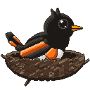
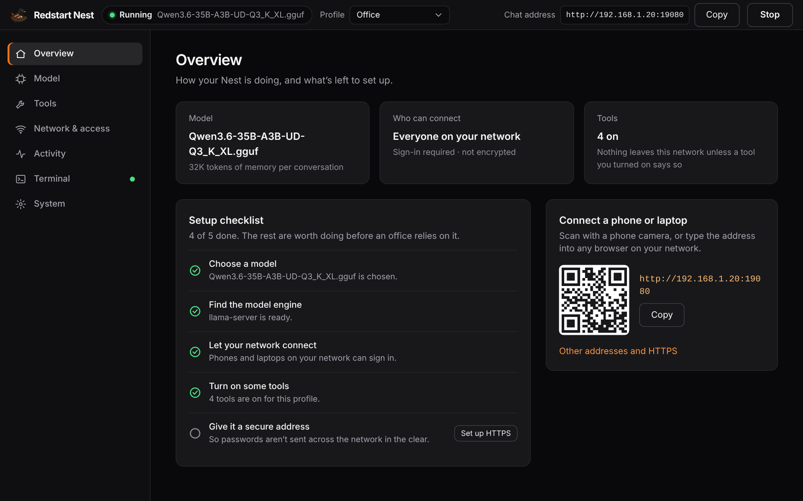
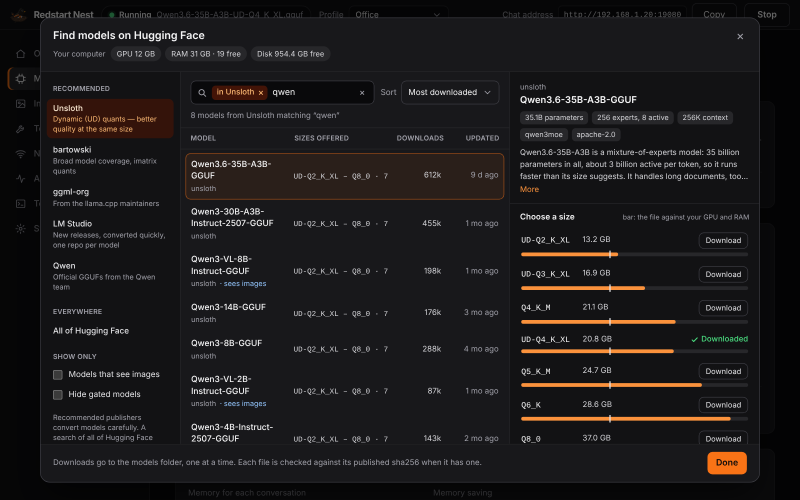
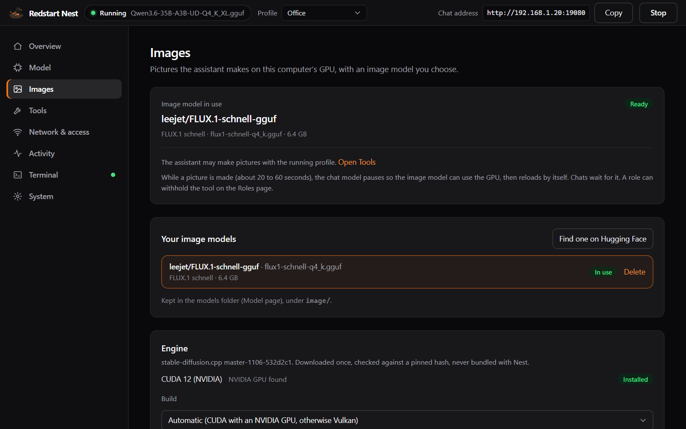
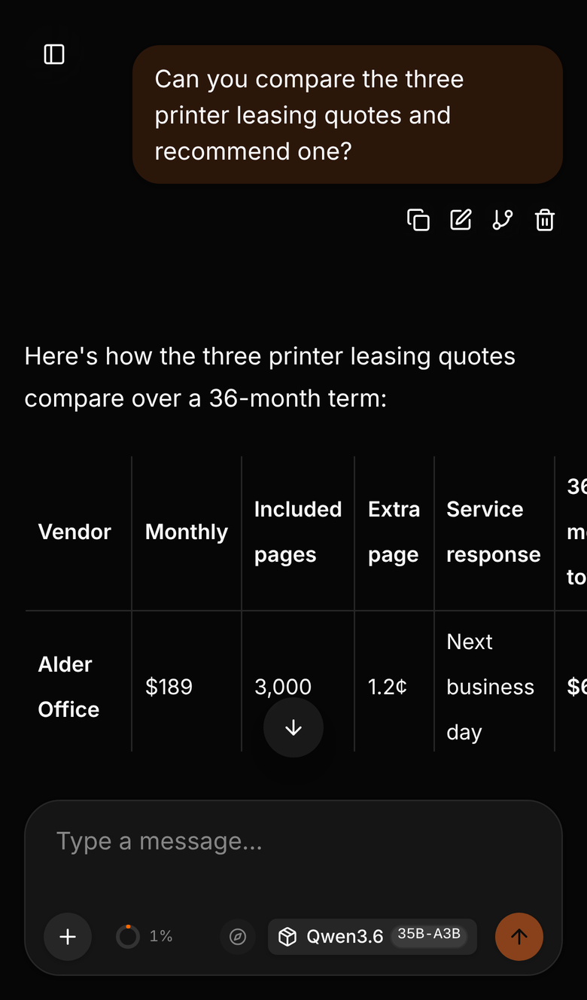
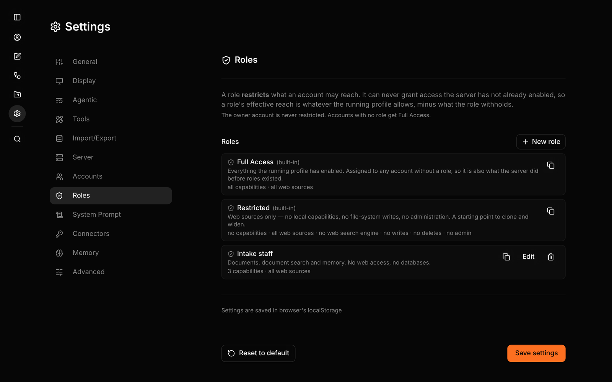

 

  

# Redstart

**A local AI server and agent platform.**

Redstart provides the infrastructure to run AI models, build agent workflows and connect applications through a centralized server environment.

At its foundation is **Redstart Nest**, a server that runs local models on hardware you own and makes them available to people, agents and applications. Use Redstart's own chat interface, connect external coding agents and AI applications, or build new software on top of the same infrastructure.

Nest combines local inference with shared tools, user management, access controls, integrations and an evolving agent runtime. Rather than requiring every application to manage its own AI infrastructure, Redstart provides a common foundation they can build upon.

**Local inference. Connected applications. AI infrastructure you control.**

**Documentation:** [Mission](docs/mission.md) · [Architecture](docs/architecture.md) · [Capabilities](docs/capabilities.md) · [Security](docs/security.md) · [Configuration](docs/configuration.md) · [Connector Contract](docs/connector-contract.md) · [Model Testing](docs/model-testing.md) · [Development](docs/development.md) · [Deployment](deploy/README.md) · [Roadmap](docs/roadmap.md)

---

> **AI Assistance Disclosure**
>
> This project was developed using Claude Code as an AI pair programmer. Product direction, architecture, user experience and technical decisions are human-directed, with AI assistance used for implementation, debugging and code generation.

---

## See Redstart in action

  

**The chat interface**

Nest serves its chat interface directly, so you can connect from any browser on your network without installing a client.

**Local image generation**

Generate images using models running on your own hardware. Nest manages the transition between the chat model and image model.

**Redstart Nest administration**

Manage models, hardware, tools, users, networking and server configuration from one place.

<b>Explore more screenshots</b> — model management, integrations, networking and accounts

### Nest administration

### Chat and organization

Screenshots are captured from the project's own code. The Nest pages and generated image are from a real run on the tested hardware. Some earlier chat screenshots use a stand-in model server with scripted responses.

---

## What is Redstart?

Redstart is built around a simple idea: **AI infrastructure should be something applications can share, not something every application has to build independently.**

### Redstart Nest

Nest is the central server and foundation of the platform.

It runs local inference and provides the services that connected clients and applications use.

- **Local inference:** Run GGUF models using llama.cpp on hardware you control.
- **OpenAI-compatible API:** Connect existing applications and coding agents through a familiar interface.
- **Shared capabilities:** Provide access to files, documents, databases, repositories, web resources and other tools.
- **User management:** Manage accounts, groups, roles, permissions and resource access.
- **Centralized administration:** Configure models, integrations, network access and server behavior in one place.
- **Application integration:** Connect independent applications through documented HTTP and MCP interfaces.
- **Network discovery:** Find Nest from compatible clients on the local network without manually configuring every connection.

Nest acts as the common infrastructure layer. Applications can use its inference services and configured capabilities without needing to implement their own model management or server infrastructure.

### Connected clients

Redstart includes its own clients, but using them isn't a requirement.

- **Redstart Twig:** A desktop chat client that discovers and connects to Nest.
- **Browser:** Access the chat interface directly from any compatible browser.
- **External applications:** Connect OpenAI-compatible applications, coding agents and other software through Nest's interfaces.

An application can use Nest simply as an inference provider, or integrate more deeply with its tools and capabilities.

---

## The agent runtime

One of Redstart's active development areas is its agent runtime.

The goal is to make local models more useful on complex, multi-step tasks, particularly smaller models that may struggle when asked to manage planning, context and tool usage entirely on their own.

Rather than relying entirely on the model to coordinate every aspect of a task, Redstart provides supporting infrastructure for:

- **Planning:** Break larger tasks into manageable steps and track progress.
- **Clarification:** Ask the user for missing information instead of making unsupported assumptions.
- **Memory:** Retain useful facts, preferences and project state across conversations.
- **Tool discovery:** Retrieve relevant capabilities as needed rather than overwhelming the model with every available tool.
- **Controlled execution:** Require approval for changes and destructive operations.
- **Persistent tasks:** Continue longer-running work on the server, including across restarts.

The runtime is actively being developed and evaluated. Its reliability and effectiveness vary depending on the model, task and available hardware.

The objective isn't to make smaller models equivalent to larger ones. It's to explore how better orchestration, context management and supporting infrastructure can help local models accomplish more.

Agent and memory benchmarks are maintained in the repository, with model-specific results documented in [Models Tested](docs/model-testing.md).

---

## Connecting external agents and applications

Redstart isn't intended to require developers to adopt its own chat interface or agent runtime.

Nest exposes an OpenAI-compatible chat completions endpoint, allowing compatible applications to use it as their inference provider.

For example, coding agents such as [Kilo Code](https://kilocode.ai/) and [Continue](https://www.continue.dev/) can connect to a local Nest instance instead of a hosted inference provider.

These applications retain their own agent runtimes and workflows. They don't automatically inherit Nest's agent orchestration, but they can use Nest's inference services and supported integration interfaces.

Applications that need deeper integration can use Redstart's connector contract and MCP capabilities.

This separation is intentional: Nest should remain useful regardless of which client or agent framework someone prefers.

**For developers:** [Connector Contract](docs/connector-contract.md) · [Tool Namespacing](docs/tool-namespacing.md) · [Architecture](docs/architecture.md)

---

## Capabilities

Nest provides a range of built-in capabilities that can be enabled and configured by the server administrator.

| Area | Capabilities |
|---|---|
| Files and documents | Read, create, organize and retrieve documents |
| Python | Sandboxed Python execution with common data and plotting libraries |
| Vision | Analyze attached images and screenshots using compatible vision models |
| Image generation | Generate images using locally hosted image models |
| Databases | Read-only access to configured PostgreSQL and SQLite databases |
| Development | Access configured Git repositories and development resources |
| Document search | Hybrid word and embedding search with source citations |
| Web access | Configured web search, approved-source fetching and academic search |
| Memory | Persistent facts, guidance and project state |
| Extensibility | Third-party MCP servers and plugins |

Capabilities are governed by server-side configuration and access policies. Administrators can control which tools are available, which accounts can use them and which resources they can access.

See [Tools & Capabilities](docs/capabilities.md) for the complete list and configuration details.

---

## Control over your environment

Local inference is a central part of Redstart's design, but local inference alone doesn't guarantee that an application or agent operates locally or securely.

Redstart takes an administrator-controlled approach to access and external connectivity.

- Models run on hardware you own.
- Accounts and roles determine who can access server resources.
- Tool permissions determine which capabilities are available.
- External connections and approved web access are explicitly configured.
- Applications authenticate through their own connector credentials.
- Administrative access is separated from ordinary chat access.

Redstart supports external services and network access when configured. The goal isn't isolation from the outside world; it's giving administrators control over what connects, what leaves and what resources are accessible.

The default inference path does not transmit conversations to a hosted AI provider. However, enabling external tools, web access or third-party integrations can involve sending data outside the machine.

**Local inference with administrator-controlled egress.**

See [Security & Trust Boundaries](docs/security.md) for details about data handling, permissions and external connectivity.

---

## Getting started

<badge color="warning">Alpha software</badge>

Redstart is under active development. Releases are published as prereleases, and some platforms and features are not yet production-ready.

### Requirements

**Redstart Nest**
- Windows 10/11 is the primary supported server platform.
- A GPU with at least 6 GB VRAM is recommended.
- A compatible GGUF model.
- Additional system RAM depending on model size and configuration.

**Redstart Twig**
- Windows 10/11 desktop.
- macOS builds are available but remain experimental.
- Android client is currently out of date and not working.

A browser can be used on Android instead of the Android client.

### Installation

1. Visit [GitHub Releases](../../releases).
2. Download the latest Redstart Nest installer.
3. Install and open Nest.
4. Complete the initial Owner setup.
5. Select a compatible GGUF model.
6. Start the server.

Once Nest is running, you can access its chat interface locally or enable network access to connect other devices.

See the [Configuration Guide](docs/configuration.md) for setup options and the [Deployment Guide](deploy/README.md) for service deployment.

**Important:** Network access and HTTPS are configurable. Review the [Security Guide](docs/security.md) before exposing services to other networks. Redstart is alpha software and should not be relied upon in environments where service interruption or data loss would be unacceptable.

---

## Project status

Redstart is actively developed, with Nest as the primary development focus.

| Component | Status |
|---|---|
| Redstart Nest | Active development; Windows is the primary supported server platform |
| Redstart Twig Desktop | Available for Windows; macOS builds are experimental |
| Redstart Twig Android | Out of date and currently not working |
| Agent runtime | Functional, actively being developed and evaluated |
| Linux deployment | Under development; not yet validated on real hardware |

Some features are functional but still need broader testing. The project has known limitations involving platform support, deployment, external integrations and security hardening.

See the [Roadmap & Known Limitations](docs/roadmap.md) for current development priorities and outstanding issues.

---

## Building on Redstart

Nest is designed to provide shared AI infrastructure for applications beyond its own clients.

[Yellowscript](https://github.com/ImDeadWeight/redstart-yellowscript) is an example of this direction: a coding agent being developed to use Redstart's server infrastructure rather than independently managing its own local AI environment.

Longer term, I want to explore additional applications built around the same foundation, including:

- **Blueprints:** A local-first SQL data workbench with optional AI assistance.
- **Greenhouse:** A project management application with optional AI capabilities.

These are future development directions, not currently available Redstart products.

The broader goal is to make Nest useful beyond the Redstart interface itself, providing a common foundation that different applications and workflows can build upon.

---

## Development and contributing

Redstart is open source and contributions are welcome.

- [Development Guide](docs/development.md)
- [Contributing Guidelines](CONTRIBUTING.md)
- [Architecture](docs/architecture.md)
- [Roadmap](docs/roadmap.md)

To run Nest without the desktop shell, the repository also includes a headless daemon.

See the [Development Guide](docs/development.md) for environment setup, testing, repository structure and build instructions.

---

## Acknowledgements

- [llama.cpp](https://github.com/ggml-org/llama.cpp) — Local inference engine.
- [TurboQuant](https://github.com/TheTom/llama-cpp-turboquant) — llama.cpp fork previously bundled by Redstart and still supported as a custom binary.
- [Unsloth](https://huggingface.co/unsloth) — GGUF model quantizations used during development.
- [llama.cpp web UI](https://github.com/ggml-org/llama.cpp/tree/master/examples/server) — The upstream chat interface on which Redstart's chat frontend is based.

See [THIRD-PARTY-NOTICES.md](THIRD-PARTY-NOTICES.md) for third-party licenses and attribution.

---

## License

Copyright (C) 2025-2026 Patrick Carswell.

Redstart is licensed under the [GNU Affero General Public License v3.0](LICENSE) (`AGPL-3.0-only`).

- **Independent applications and connectors:** Applications communicating with Nest through its documented HTTP, MCP or other interfaces are separate works and may use their own licenses, including proprietary licenses.
- **Your output:** Conversations, documents, code and other output produced using Redstart aren't covered by Redstart's license.
- **Earlier releases:** Releases up to and including `1.0.0-alpha.12` were published under MIT. Those copies remain under MIT.
- **Commercial licensing:** Contact the project through GitHub to discuss commercial licensing.
- **Trademarks:** Redstart, Redstart Nest, Redstart Twig and the mascot artwork are trademarks and aren't covered by the AGPL. See [TRADEMARKS.md](TRADEMARKS.md).
- **Contributing:** Contributors sign a [Contributor License Agreement](CLA.md). See [CONTRIBUTING.md](CONTRIBUTING.md).

Third-party components retain their respective licenses. See [THIRD-PARTY-NOTICES.md](THIRD-PARTY-NOTICES.md).
