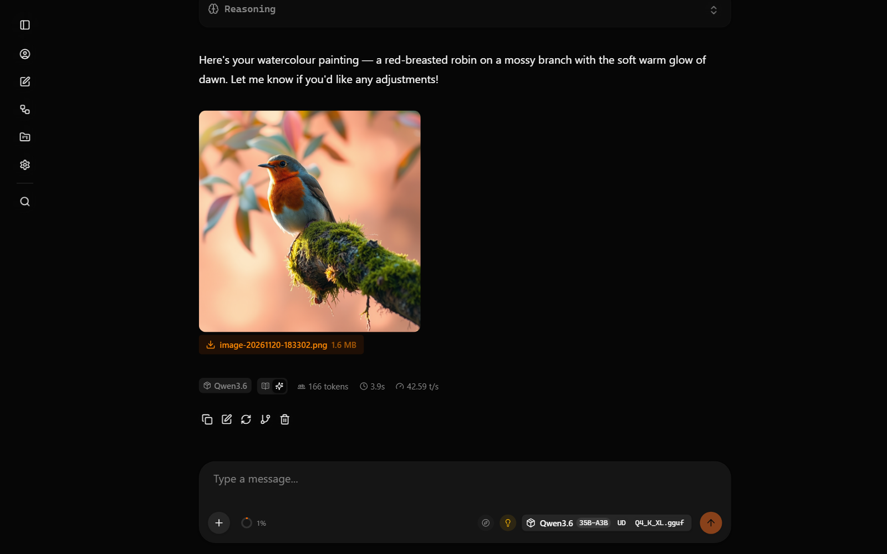
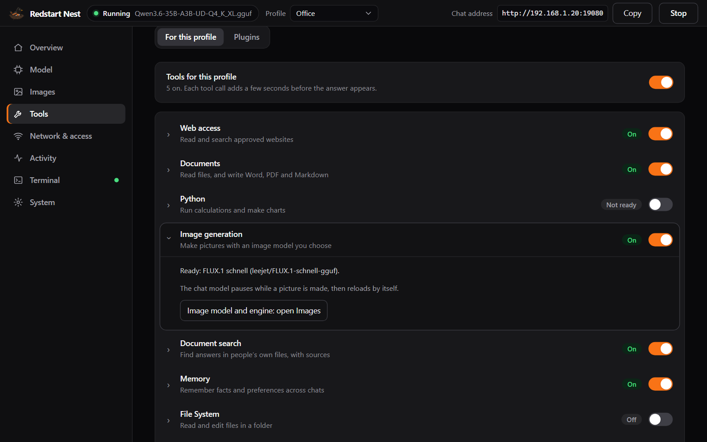
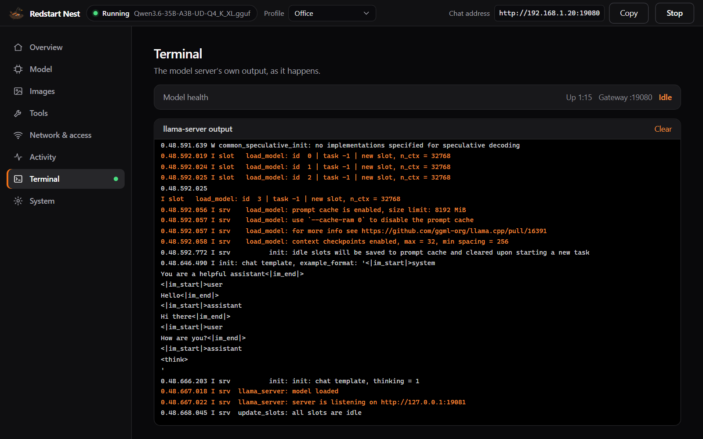
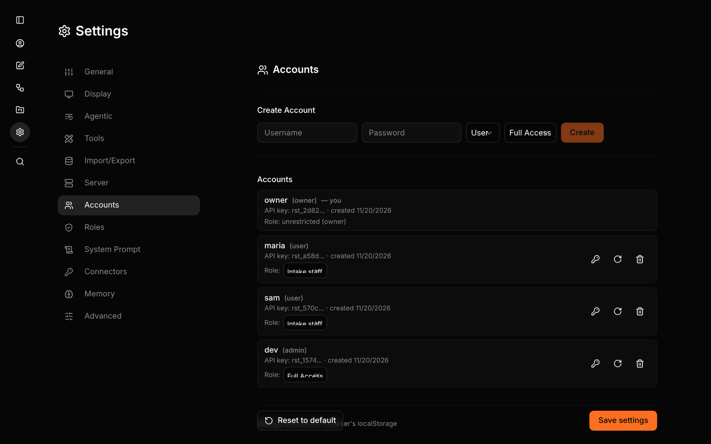

<p align="center">
  
</p>

# Redstart

**A local AI server for a household or small team.** Redstart Nest runs local models on hardware you own and exposes them to the applications you work in — chat from your phone or laptop, query your data, or drive a coding agent in your IDE. You choose the models, decide which applications and users can connect, and control what those tools can reach.

LM Studio, Jan and Ollama are model runners — very good ones — aimed at getting a model going on the PC in front of you. Redstart is the layer after that: accounts, tool policy and network discovery, so the model on the GPU box is usable from every device in the house. [How it compares](#alternatives-worth-knowing-about).

**Documentation:** [Mission](docs/mission.md) · [Architecture](docs/architecture.md) · [Security](docs/security.md) · [Capabilities](docs/capabilities.md) · [Configuration](docs/configuration.md) · [Development](docs/development.md) · [Deployment](deploy/README.md) · [Roadmap](docs/roadmap.md)

---

> **AI Assistance Disclosure**
> This project was developed using Claude Code as an AI pair programmer. I designed the product, architecture, user experience, and technical direction, while using Claude to accelerate implementation, debugging, and code generation. All design decisions and final technical choices were made by me.

---

## Screenshots

<p align="center">
  
</p>
<p align="center"><sub>A short tour that advances on its own: the chat, the Nest admin panel, a picture being made, then the chat's admin settings. Every image below opens full size when clicked.</sub></p>

**The chat** — served by Nest to any browser on your network, or through Redstart Twig.

<a href="docs/screenshots/chat-conversation.png"></a>

**Pictures, made on your GPU** — asked for a picture, the model calls `generate_image`; Nest pauses the chat model, makes it with the image model you chose, and brings the chat model back.

<a href="docs/screenshots/chat-image.png"></a>

**Redstart Nest** — the admin panel: status and Start/Stop on top, every setting in seven sections down the side.

<a href="docs/screenshots/nest-overview.png"></a>

<details>
<summary><b>More of Redstart Nest</b> — Model, Images, Tools, Network &amp; access, Terminal</summary>
<br>

**Model** — your models, the hardware, and memory settings in plain words; the llama.cpp flags sit under Advanced.

<a href="docs/screenshots/nest-model.png"></a>

**Images** — the picture model, the way Model is the chat model: the image model in use, your image models, finding one on Hugging Face, and the engine.

<a href="docs/screenshots/nest-images.png"></a>

**Tools** — one row per tool with its switch; opening a row shows its settings.

<a href="docs/screenshots/nest-tools.png"></a>

**Network &amp; access** — who can connect, the addresses and QR code, HTTPS, and sign-in.

<a href="docs/screenshots/nest-network.png"></a>

**Terminal** — the model server's own output, live.

<a href="docs/screenshots/nest-terminal.png"></a>

</details>

<details>
<summary><b>More of the chat</b> — on a phone, Accounts, Roles, Workflows, System prompt</summary>
<br>

**On a phone** — the same chat, no app needed.

<p align="center"><a href="docs/screenshots/chat-phone.png"></a></p>

**Accounts** — each person signs in with their own account, and their files and history are theirs alone.

<a href="docs/screenshots/chat-accounts.png"></a>

**Roles** — what an account may reach: a role only ever takes away.

<a href="docs/screenshots/chat-roles.png"></a>

**Workflows** — saved instructions for recurring work, personal or shared, run by typing <code>/</code>.

<a href="docs/screenshots/chat-workflows.png"></a>

**System prompt** — the organisation's context, policy and format, composed by the server for every client.

<a href="docs/screenshots/chat-system-prompt.png"></a>

</details>

<sub>All captured from this repository's own code. The Nest pages and the picture are from a real run on the tested hardware below: Qwen3.6-35B-A3B answering, FLUX.1 schnell drawing, the network address replaced with a stand-in. The other chat screens were captured earlier against a stand-in model server, so those answers are scripted.</sub>

---

## What Nest does

**Redstart Nest is the server.** It runs the model, and it owns the four things a
model on its own doesn't have: who may use it, what it may reach, how devices
find it, and who may administer it. Everything else — Twig, a browser, a coding
agent — is a client that connects and gets whatever the admin configured once.

- **Runs the model.** llama.cpp on your hardware, bound to loopback, driven from a launcher that handles model files, GPU offload and the server lifecycle. Closing the window doesn't stop it; it keeps serving from the tray.
- **Serves every device on the network.** Nest broadcasts a beacon, so Twig finds it with no configuration and a phone camera can open the chat UI from a QR code. The chat UI is served by Nest itself, so any browser works with nothing installed.
- **Owns accounts and roles.** Login is on by default with no localhost exemption, roles are assigned per account, and each account's files are structurally isolated from every other's.
- **Owns the tool policy.** Capabilities and plugins are configured once on the server and apply to every client. Each client authenticates with a per-connector key that carries its own *surface*, so the server knows which app is calling from the credential rather than from a header it could fake.
- **Keeps control separate from chat.** The admin plane is a different port, a different lifetime and a different login: signing in to the chat UI does not give you process control.
- **Serves HTTPS on the LAN if you want it.** Turn on *Secure address* and Nest's bundled Caddy serves the chat UI at `https://<name>` with a real Let's Encrypt certificate: an Automatic name from Redstart's name service, or your own DuckDNS or deSEC name. Certificates come by DNS challenge, so nothing on the internet ever connects in. Off by default; while it is off, the chat UI says the connection is not encrypted.
- **Controls egress explicitly, and will tell you.** Nothing about a conversation leaves by default; what can leave is exactly what an admin turned on, and `GET /egress` returns the live answer.

### Redstart Twig

The chat client that ships in this repo — a lightweight app that finds Nest on
the LAN and signs in, with no hostname to type. **Windows works; the macOS
build has not been run on a Mac yet** (Nest has: [Mac testing so far](#mac-testing-so-far)). **The Android build is out of date and paused** ([see note](#redstart-twig-android)); a phone
browser against the chat UI is the working substitute in the meantime.

Since llama-server speaks the OpenAI API, [coding agents](#using-as-a-coding-agent-kilo-code--continue--etc) and any other OpenAI-compatible application are clients too, with no Redstart-specific code.

---

## What the assistant can do

The chat is an agent, not just a text box: it works with tools on your own data, asks before it changes anything, and keeps going when the page is closed. Every capability is off until an admin turns it on, and a role can withhold any of them from an account or narrow a shared folder to some of its subfolders.

**Work with your data** ([Capabilities](docs/capabilities.md))
- **Files and documents.** Read PDFs, Word, Excel, CSV and Markdown; create `.docx`, `.pdf` and `.md` files that appear in the chat as downloads. Each account's files are its own.
- **Run Python.** `run_python` runs numpy, pandas and matplotlib in a WebAssembly sandbox with no network and no access outside the conversation's own folder. Charts come back as images.
- **See images.** With a vision model (Qwen3-VL, Gemma 3 and others), it reads photos and screenshots you attach, and looks at image files with `view_image`. Nest downloads a vision model's projector with it and loads it automatically.
- **Make pictures.** `generate_image` draws with an image model you pick on Hugging Face (FLUX.1 schnell is the tested one; FLUX.1 dev, SDXL and SD 1.x checkpoints work the same way), on this machine's GPU with stable-diffusion.cpp. A 12 GB card cannot hold both models, so the chat model pauses for the 20 to 60 seconds a picture takes and comes back by itself; other chats wait rather than fail. Set up on Nest's Images page.
- **Search your own files with citations.** Hybrid word and embedding search over uploads, attachments and created documents, with numbered sources linked back to each file. An admin can add a **Shared Documents** folder (policy manuals, templates, reference material) that everyone searches read-only, as far as their role allows.
- **Query databases and repositories, read-only.** Postgres and SQLite (enforced by a read-only transaction, not by inspecting the SQL), a folder of Markdown notes, local Git repositories.
- **Reach the web, only where allowed.** Fetch from approved sources, search, and look up academic papers (OpenAlex, arXiv, PubMed).
- **Add more.** Install a third-party MCP server as a [plugin](docs/capabilities.md#plugins); its tools get the same policy as the built-ins.

**Work like an agent**
- **Asks instead of guessing.** When a task depends on something only you know, it asks: up to four questions at once, as a card with choices.
- **Plans longer work.** Multi-step tasks get a checklist in the chat that it ticks off as it goes.
- **Asks before it changes anything.** Writes and deletes stop at an approval card in the chat, checked by the server for every client, not just this one. "Always allow" makes a standing grant for a tool (never for deletion), and the launcher's Activity page shows every decision. Deletions go to the Recycle Bin.
- **Keeps going when you close the page.** Chats run on the server by default, so a refresh, a closed tab or a sleeping phone doesn't end the reply. `/task <request>` hands a longer job to the server outright. Both survive a restart and wait for you in the chat when they need an answer or an approval.
- **Sends only the tools a chat needs.** Capabilities marked catalog-only stay out of the prompt, and the model finds them with `search_tools` when it needs one, ranked by a small local embedding model. A dozen capabilities don't crowd a small model's context. On by default; per profile on the Tools page.

**Remember what matters** ([Memory](docs/security.md#memory))
- **Three kinds of memory:** facts about you, how you want it to work (followed, with your reason), and where a piece of work stands (dated, and flagged when old).
- **Automatic, under your control.** After a chat goes quiet it suggests what is worth keeping. Every suggestion quotes the words of yours it is based on, and nothing from a web page or file can become a memory. Suggest (the default) waits for you; Automatic saves with Undo; a "forget" is never applied on its own.
- `/remember guidance: put the command first because I paste it straight into a terminal` saves one yourself. Settings → Memory shows, edits and deletes all of them.

**Organise the work**
- **Projects** group chats with their own instructions, files and memories. A project's instructions import from and export to `AGENTS.md`.
- **Workflows** are saved instructions for recurring tasks, personal or shared across the organisation, run by typing `/`. They are stored as Agent Skills (`SKILL.md`), import and export as `.zip` or `SKILL.md`, and the model can load one itself with `use_skill` when it fits the task.
- **Slash commands** for the rest: `/new`, `/model`, `/mode`, `/project`, `/compact`, `/task`, `/remember`, `/memory`, `/retry`, `/copy`, `/rename`, `/export`, `/help`.

**Measured, not assumed.** The repo carries an agent benchmark (32 tasks against a real Nest) and a memory benchmark (32 cases, including prompt-injection attempts), and the numbers on each model are recorded before a change ships.

---

## How it works

```
[ GPU PC ]                              [ Phone / Laptop / VS Code / Browser ]
  Redstart Nest                            Redstart Twig  /  Kilo Code
  ├─ Gateway     :19080 (LAN in network mode) ├─ Scans LAN on port 8765
  │   └─ Injects Redstart context      ├─ Finds Redstart Nest automatically
  ├─ llama-server :19081 (localhost)   └─ Connects to http://IP:19080
  ├─ MCP server   :19082 (web, Documents, Python, Image generation, document search, Memory, File System, SQLite, Postgres, Vault, Git, Scholar, plugins)
  ├─ Admin plane :19083 (the launcher UI, in a browser — owner only, loopback by default)
  └─ Beacon      :8765
```

The chat UI is reachable in any browser at `http://127.0.0.1:19080`, and at the Nest machine's LAN address once network mode is on — no app required.

**Two planes, two lifetimes.** 19080/19081/19082 exist because a model is running and go away when it stops. **19083 is the control plane** — it binds when Redstart Nest starts and stays up whether or not a model is, because a plane whose lifetime is tied to the thing it controls cannot be used to start that thing. It serves the same launcher interface in a browser, so the box can be administered from another device, and it authenticates separately: signing in to the chat UI does *not* give you process control. It listens on loopback unless you deliberately move it.

Details: [Architecture](docs/architecture.md) · [Capabilities](docs/capabilities.md) · [Security](docs/security.md)

---

## Control, not isolation

Inference is local and architecturally so — llama-server runs on your machine, bound to loopback, and nothing about a conversation is transmitted anywhere by default. What *can* leave is exactly what an administrator turns on: approved web domains, academic search, an external tool server on another host, or an installed [plugin](docs/capabilities.md#plugins) configured with a credential. Each is an explicit, auditable choice.

The honest one-line version is **local inference with administrator-controlled egress**, and the server will tell you the live answer — `GET /egress` returns which domains are approved, which tool servers are remote, and which local stores exist. See [Security → What actually leaves the machine](docs/security.md#what-actually-leaves-the-machine).

Accounts are **on by default** with no localhost exemption, and each account's files are structurally isolated from every other's. **Do not expose the gateway port to the public internet.**

---

## Requirements

**Redstart Nest (server)**
- Windows 10/11
- A GPU with at least 6 GB VRAM (NVIDIA recommended; llama.cpp supports CUDA and Vulkan)
- A GGUF model file
- For pictures: an image model (FLUX.1 schnell Q4_K is about 10 GB with its shared files; it peaks near 11 GB of VRAM while drawing, with the chat model paused)

**Redstart Twig (Android)** — Android 10 or later, on the same Wi-Fi network as the Nest PC. **Not currently working** — [see note](#redstart-twig-android).

**Redstart Twig (desktop)** — Windows 10/11, or macOS on Apple Silicon (not yet run on a Mac; Nest has been), on the same network as the Nest PC (or on the same machine).

---

## Installation

> **Alpha software.** Releases are published as prereleases and versioned
> `1.0.0-alpha.N`. Expect rough edges, and do not run this where losing data or
> exposing a service would matter.

### Redstart Nest
1. Download the latest `Redstart-Nest-Setup-1.0.0-alpha.N.exe` from [Releases](../../releases)
2. Run the installer — Windows Defender may warn about an unsigned binary, click **More info → Run anyway**
3. Open Redstart Nest. It opens on a setup screen asking for this machine's **setup code** and the Owner credential you want. On the host itself the code is filled in for you; it also lives in plain text at `bootstrap-token.txt` in Nest's config folder. Login is required by default, so until an Owner exists no device — including a browser on this PC — can sign in to the chat UI. (Home users who don't want accounts can flip **Require login** off afterwards.)

   The setup code is a **recovery credential, not a password** — it is deliberately stored in plain text and meant to be readable by whoever has physical access to the box, like the sticker on the bottom of a router. It is also the way back in if the Owner password is lost: the same screen re-keys the Owner account, which signs out every existing session.
4. Point it at a `.gguf` model file and click **Start Server**
5. In **Network & access**, choose **Everyone on my network** to make the server reachable from other devices — each person signs in with an account the Owner/Admins create. The same panel shows the addresses to browse to, including a QR code to scan from a phone

**Closing the window does not stop the server.** Redstart Nest keeps running in the tray so the model stays available to everyone else on the network; reopening the window reconnects to the daemon that was already running. To actually stop it, use **Shut down** in the launcher or **Quit Redstart** in the tray menu.

**Administering it from another device** is off by default. The same Network & access page has a second switch for the admin panel itself — separate from the one above, because making the chat UI reachable and making *process control* reachable are different decisions. Turn it on and the launcher interface is available at `http://<nest-ip>:19083`, Owner account only.

### Redstart Twig (Android)

> **Currently out of date and not working.** The Android client has fallen behind
> the server and has not been rebuilt against recent Nest changes; the published
> APK should not be relied on. This is paused, not abandoned — returning to it is
> planned, but it is not being worked on right now.
>
> **In the meantime, use a phone browser instead.** The chat UI is served directly
> by Nest, so browsing to `http://<nest-ip>:19080` — or scanning the QR code in
> **Network & access** — gives you the same interface on Android with no app
> installed. Redstart Twig for Windows is unaffected and works normally.

1. Download `redstart-twig.apk` from [Releases](../../releases)
2. On your phone, allow installation from unknown sources (Settings → Apps → Special app access → Install unknown apps)
3. Install the APK
4. Open the app — it finds the server automatically by scanning the LAN for the beacon on port 8765; no hostname or QR code needed

### Redstart Twig (Windows)
1. Download the latest `Redstart-Twig-Setup-1.0.0-alpha.N.exe` from [Releases](../../releases)
2. Install and open — it scans your network automatically

Twig updates itself from then on: it downloads a new release in the background and installs it when you close it.

### macOS (experimental)

Each release also carries `.dmg` installers — Nest for Apple Silicon, Twig for Apple Silicon (`arm64`) too. **Mac testing has started:** Nest has been run on an Apple Silicon MacBook, and the issues it turned up are listed below. Twig has not been run on a Mac yet. Treat both as a preview. They are not notarized: after dragging the app to Applications, the first launch is blocked until you choose **Open Anyway** in System Settings → Privacy & Security.

What else to expect on a Mac:
- **Models and files live in `~/Redstart`** (Models, Documents, SQLite, Vault), not in `~/Documents`, which macOS asks permission for. An install that already used `~/Documents/Redstart` keeps it.
- **"Allow incoming connections?"** appears the first time network mode is on, if the macOS firewall is turned on (it is off by default). Choose Allow, or other devices can't reach Nest. Because the builds are not notarized, macOS may ask again after an update.
- **Models in other folders:** the file picker has a sidebar like Finder's: the models folder, recent folders, LM Studio's and the Hugging Face cache's model folders when they exist, Home, Desktop, Documents, Downloads, and each volume under `/Volumes`. **Show hidden folders** reveals the rest, and **Type path** takes a pasted path (in Finder, Option-Command-C copies one). ⌘↑, ⌘[ and ⌘] go up, back and forward.
- If a folder says macOS blocked access, allow Redstart Nest in System Settings → Privacy & Security → Files and Folders.

Removing the first-launch block needs an Apple Developer ID certificate and notarization, tracked in [roadmap → Signed installers](docs/roadmap.md).

#### Mac testing so far

The first hands-on test (Nest on an Apple Silicon MacBook, reported 2026-11-22) found two problems. Both are fixed in code and **waiting for a re-test on a Mac**:

| Found on the Mac | Cause | Fix |
|---|---|---|
| The Model page said the machine had **0 GB of memory** | The hardware check was a Windows PowerShell script; on macOS it failed silently. Unified memory was never read | A macOS check (`sysctl`, `vm_stat`). On Apple Silicon the GPU is shown as sharing the system's memory: "up to N GB of M GB unified memory" |
| **Couldn't choose a model outside the models folder** | The file picker listed folders only and asked for the file name to be typed; it skipped symlinked files and could not reach hidden folders | The picker lists `.gguf` files (symlinked ones included) and takes a pasted path |

Since then, the GPU line on the Model page comes from the bundled llama-server itself (`llama-server --list-devices`), so on a Mac it shows the Metal device's own figure; also not yet re-tested on a Mac.

Going through the code for anything else Mac-specific turned up four more, fixed in the same pass and not yet seen on a Mac either: the default folders moved out of `~/Documents` (macOS asks permission for it); Twig's "find my Nest" scan opened more connections at once than a Mac allows one app and could find nothing; both apps could pick a VPN or bridge adapter as the LAN address; and some wording assumed Windows. Details are in the [changelog](CHANGELOG.md) under 2026-11-22.

Not tried on a Mac yet: loading and chatting with a model on the Metal engine, image generation, network mode and HTTPS, auto-update, and Twig.

---

## Using as a coding agent (Kilo Code / Continue / etc.)

Since llama-server speaks the OpenAI API, any coding extension that accepts a custom base URL works out of the box.

**Kilo Code (VS Code extension):**
1. Open VS Code → Kilo Code settings
2. Set **API Provider** to `OpenAI Compatible`
3. Set **Base URL** to `http://127.0.0.1:19080/v1` (or your LAN IP if connecting from another machine)
4. Set **API Key** to your account's `rst_` API key (when login is on, which is the default); when login is off, any non-empty string works
5. Set **Model** to the name of your loaded model (e.g. `Qwen3.6-35B-A3B-UD-Q3_K_XL`)

The same pattern applies to [Continue](https://continue.dev/), [Aider](https://aider.chat/), or any tool with OpenAI-compatible configuration.

---

## Tested configuration

The hardware and models used during development, all on one machine. Results will vary by GPU, quantization level, and task type; no model has been benchmarked on macOS, Linux, or an AMD or Apple GPU yet (Mac testing of the app itself has started: [Mac testing so far](#mac-testing-so-far)).

| | |
|---|---|
| **CPU** | AMD Ryzen 7 7700X |
| **GPU** | NVIDIA RTX 3060 12 GB |
| **RAM** | 32 GB DDR5 |
| **OS** | Windows |
| **Engine** | llama-server, the bundled TurboQuant+ build |

| Model | Quant | Measured |
|---|---|---|
| [Qwen3.6-35B-A3B](https://huggingface.co/unsloth/Qwen3.6-35B-A3B-GGUF) | `UD-Q3_K_XL` | 41–45 tokens/sec writing a 5-page report (29 s in all), with llama-server's `--fit` placing the layers and **Disable memory-mapping** on (Model page, advanced); ~25–30 tokens/sec before `--fit` replaced a fixed manual split. The best agent-bench scores (21/24 on the early task set) |
| Ornith 1.5 9B | `Q6_K` | ~40 tokens/sec alone, 35–36 each with two requests at once; up to 128k context on the 12 GB card. Most of the agent runtime was tuned on it: 76–81% of the 32-task agent bench |
| [Qwen3-4B-Instruct-2507](https://huggingface.co/unsloth/Qwen3-4B-Instruct-2507-GGUF) | `UD-Q4_K_XL` | The small-model floor: 58–67% of the earlier 24-task agent bench. Needs its own embedded chat template, which Nest now checks for |

The benchmark rows, what each model taught the code, and how to run the benches yourself: [Models tested](docs/model-testing.md).

**The 35B model:** Qwen3.6-35B-A3B is an Alibaba mixture-of-experts model (llama.cpp architecture `qwen35moe`) with a hybrid Gated DeltaNet and Gated Attention design, 256 experts with 8 routed and 1 shared active at a time — about 3B active parameters out of 35B. That is why it runs at a useful speed on a 12 GB card where a dense 35B would not.

**It does not fit in 12 GB of VRAM on its own.** `--fit` (llama-server's default, which Nest leaves alone unless you set GPU layers) measures free VRAM at load and keeps part of the expert tensors in system RAM. That is what the 32 GB of RAM is for, and why **Disable memory-mapping** helps: llama-server itself recommends `--no-mmap` when expert tensors are placed on the CPU. It is off by default in Nest.

**The quantization:** The `UD` prefix stands for Unsloth Dynamic — [Unsloth AI](https://huggingface.co/unsloth) applies different quantization levels to different layers rather than a flat bit-depth across the whole model, for better output quality at the same file size than a standard K-quant.

**Finding GGUF models:** [Hugging Face](https://huggingface.co) is the easiest source — [unsloth](https://huggingface.co/unsloth) and [bartowski](https://huggingface.co/bartowski) are both reliable for well-quantized GGUF files across many model families. Nest's Model page can search and download from both.

---

## Known limitations

The short list; the [full set is in the roadmap](docs/roadmap.md#known-limitations).

- **Twig for Android is out of date and not working** — the Android client hasn't been rebuilt against recent server changes. Use a phone browser against the chat UI instead. Paused, not abandoned; see [the note above](#redstart-twig-android).
- **Unsigned installers** — both will trigger Windows Defender SmartScreen; the macOS builds are not notarized, so Gatekeeper blocks their first launch.
- **Windows is the only supported server platform** — the daemon itself runs headless under plain Node and `deploy/` carries a systemd unit, and releases now include macOS `.dmg` builds. Mac testing has started ([what it found](#mac-testing-so-far)), but the Linux artifacts have not been run on real hardware yet. The port-80 proxy is Windows-only.
- **The deployment artifacts are a first draft** — `deploy/` (systemd, Windows SCM, Caddy) was written from the design and reviewed, not executed. Read each command before running it.
- **HTTPS on the LAN is opt-in and new** — with *Secure address* off (the default), LAN traffic, passwords included, is plain HTTP, and the chat UI says so. Turning it on gets a real certificate, but it has not yet run in many homes.
- **External MCP servers that need a key or OAuth don't work from the chat** — a saved API key is used only by Nest's connection test, and OAuth isn't supported. See [Capabilities](docs/capabilities.md#external-mcp-servers).
- **mDNS / `redstart.local` has been retired** — Android's resolver never answered `.local` lookups for browser navigation, so the name failed on the platform most clients are. Use the IP or the QR code; Twig's beacon scan never needed a name.
- **Postgres sharing is all-or-nothing** — a role can narrow Vault, Git, SQLite and Shared Documents to some of their folders, but Postgres has one connection, so a role can only withhold it whole.

---

## Development

```bash
cd redstart-nest
npm install
npm install --prefix ../chat-ui   # the chat-ui is its own package
node ../tooling/stage-node.mjs     # the pinned Node 26 the daemon runs on
npm run dev                        # Vite + chat-ui + the Tauri shell (needs Rust)
```

To run the server without the desktop shell (no window, no desktop session):

```bash
npm run daemon          # boots the daemon under plain Node, in ./.redstart-daemon
npm run daemon:status
npm run daemon:stop
```

Full setup, repo layout, test commands and installer builds: [Development](docs/development.md). Running it as a service: [Deployment](deploy/README.md).

---

## Alternatives worth knowing about

If you just want to run a model on a single PC, these are more mature options:

- **[LM Studio](https://lmstudio.ai/)** — polished GUI, built-in model browser, downloads GGUFs directly, OpenAI-compatible server. Windows/Mac/Linux.
- **[Jan](https://jan.ai/)** — similar to LM Studio, fully open source.
- **[Ollama](https://ollama.com/)** — CLI-first but extremely simple (`ollama run qwen3`), large ecosystem of community UIs built on top.

All three can technically be reached from other devices on your LAN if you manually configure them to bind to `0.0.0.0` — but you are then on your own for finding the IP address and entering it in whatever client you use. None have a mobile app that discovers the server automatically, and none have a QR-to-connect flow.

Redstart's niche is the thing those don't try to be: a server for a group of people rather than a runner for one PC. Making the **home network experience a first-class feature** instead of a manual network-configuration exercise, and treating **accounts, tool policy and egress control as the product** rather than something bolted on afterwards, is the whole distinction. If single-PC use is all you need, LM Studio is probably the better starting point.

---

## Direction

Nest's own roadmap — crash recovery, signed installers, guided onboarding,
macOS and Linux support, OAuth for external tool servers — is in
[Roadmap](docs/roadmap.md), along with the limitations it hasn't cleared yet.

Beyond Nest and Twig, the same server is what these are being built against.
They live in their own repos and are **not** required to use Redstart:

| App | Platform | Role | Status |
|---|---|---|---|
| **[Redstart Blueprints](https://github.com/ImDeadWeight/redstart-blueprints)** | Windows (Electron) | Local-first SQL data workbench with optional AI assistance | In progress |
| **[Redstart Yellowscript](https://github.com/ImDeadWeight/redstart-yellowscript)** | VS Code extension | A coding agent that talks to a local Nest instead of a cloud | In progress |
| **[Redstart Greenhouse](https://github.com/ImDeadWeight/redstart-greenhouse)** | Windows (Electron) | Project management, built the way Blueprints is built | Planned, not started |

What makes that plausible rather than aspirational is that the integration
points are contracts, not conventions: a client authenticates with a
per-connector key carrying its own surface, and tool names are namespaced per
app (`bp_*`, `ys_*`, `gh_*` — see [tool namespacing](docs/tool-namespacing.md)),
so a new client is a credential and a namespace rather than a change to the
server. See [Architecture](docs/architecture.md) for the full picture.

---

## Acknowledgements

- [llama.cpp](https://github.com/ggerganov/llama.cpp) — the inference engine that makes all of this possible
- [TurboQuant](https://github.com/TheTom/llama-cpp-turboquant) — the llama.cpp build and quantization tooling used here; the included `llama-server.exe` comes from this project
- [Unsloth](https://huggingface.co/unsloth) — pre-quantized GGUF models including the Qwen 3.6 model used during development
- [llama.cpp web UI](https://github.com/ggerganov/llama.cpp/tree/master/examples/server) — the upstream chat UI that the Redstart chat frontend is forked from

---

## License

Copyright (C) 2025-2026 Patrick Carswell.

Redstart is free software: you can redistribute it and/or modify it under the
terms of the [GNU Affero General Public License, version 3](LICENSE)
(`AGPL-3.0-only`). If you distribute a modified version, or let people use one
over a network, you must make its complete source code available to them under
the same license.

- **Apps that connect to Redstart aren't covered.** A program that works with
  Nest through its interfaces, such as a [connector](docs/connector-contract.md)
  over HTTP, an MCP server, or a [plugin](docs/capabilities.md#plugins) Nest
  runs as a separate process, is a separate work. It can use any license you
  like, including a proprietary one. The AGPL applies to Redstart's own code
  and to modified versions of it, not to the software that talks to it. The
  copyright holder states this as a permission, not only as a reading of the
  license, so integrators can rely on it.
- **What you make with it is yours.** Conversations, documents, code and other
  output you produce using Redstart aren't covered by Redstart's license.
- **Earlier releases.** Releases up to and including `1.0.0-alpha.12` were
  published under the MIT License, and those copies stay under MIT.
- **Commercial licenses.** To use Redstart in a product without the AGPL's
  source-sharing terms, open an issue to ask about a commercial license.
- **Name and mascot.** "Redstart", "Redstart Nest", "Redstart Twig" and the
  mascot artwork are trademarks and aren't covered by the AGPL. A distributed
  fork needs its own name and mascot. See [TRADEMARKS.md](TRADEMARKS.md).
- **Contributing.** Contributors sign a [CLA](CLA.md). See
  [CONTRIBUTING.md](CONTRIBUTING.md).

Third-party components keep their own licenses. See
[THIRD-PARTY-NOTICES.md](THIRD-PARTY-NOTICES.md).

---

## Author

Patrick Carswell — this is my first major development project, built to solve a personal problem: running a local AI on existing home hardware without sending data to the cloud. My background is in social work, not software, so some of the architecture decisions here reflect learning-by-doing as much as deliberate design. The codebase reflects that honestly.
