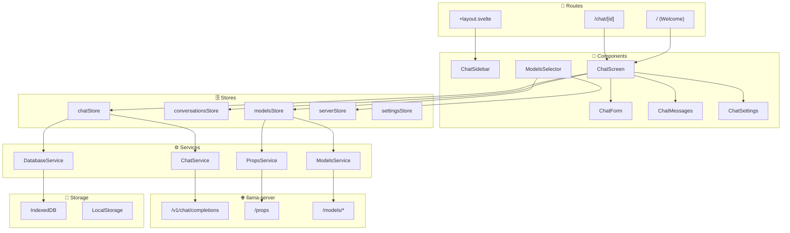
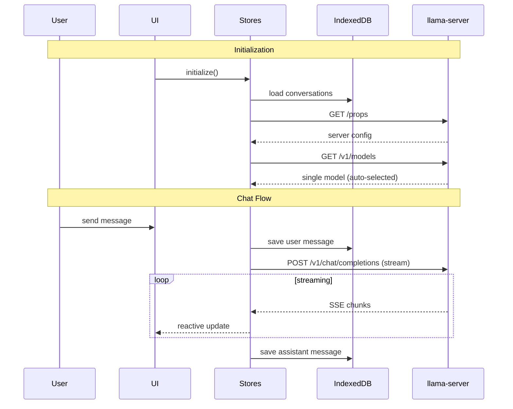
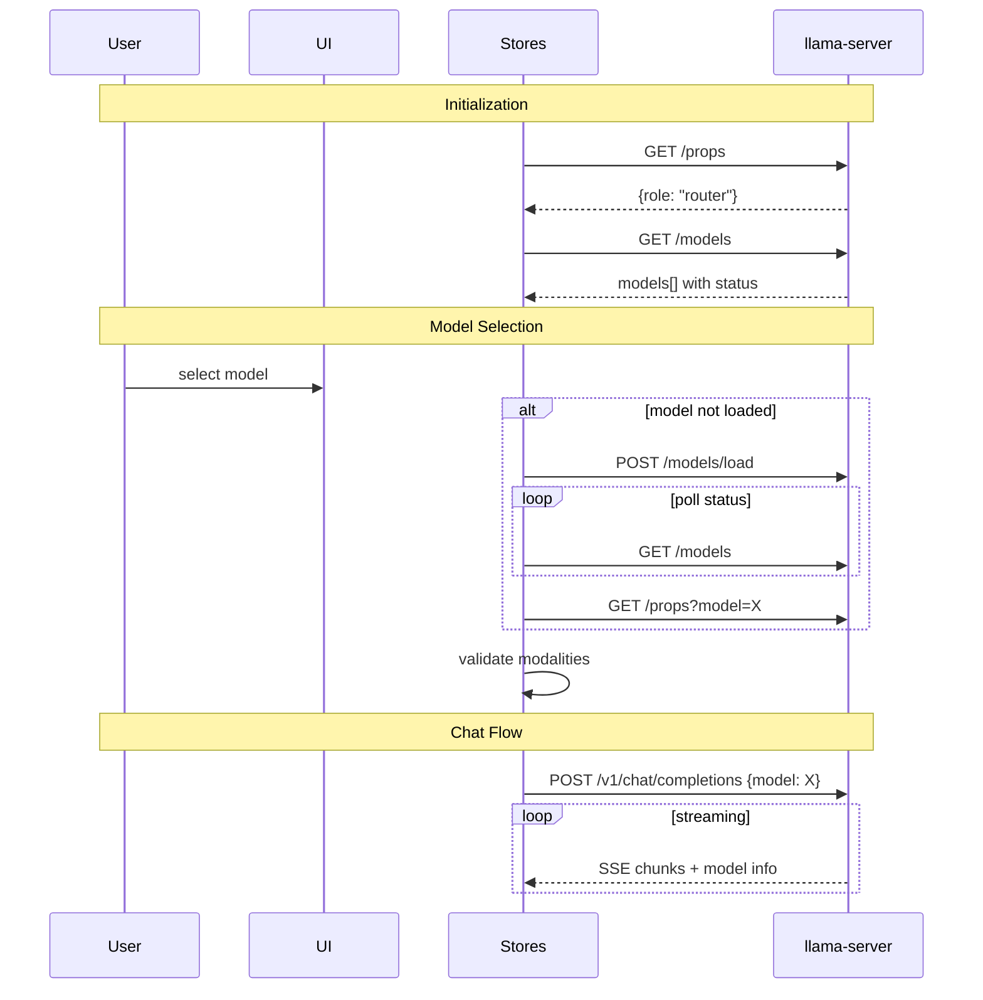
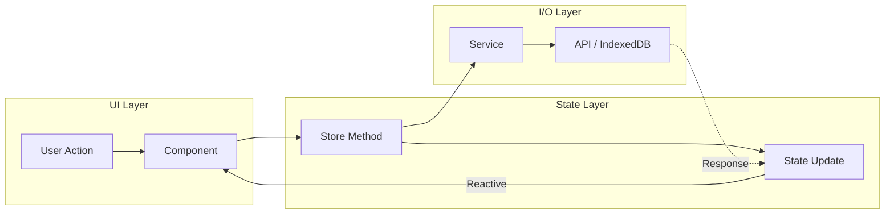
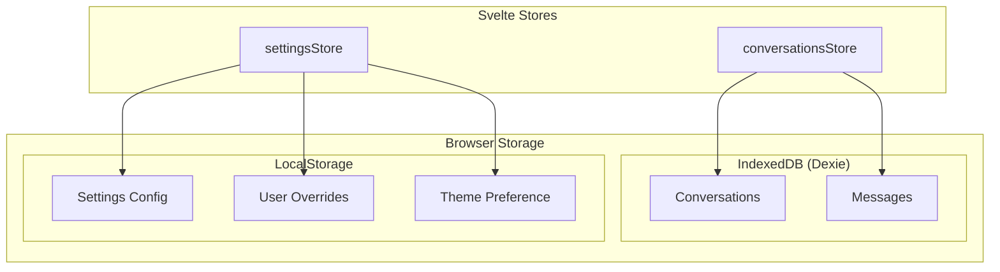

# Redstart chat UI

The chat app of Redstart: a SvelteKit single-page app that both Redstart
apps ship. **Redstart Nest** serves it to the browsers on your network (and
in its own window); **Redstart Twig** loads it in its desktop window and
points it at a Nest on the LAN.

It is its own package (`@redstart/chat-ui`) at the top of the repo. It
imports only itself and the repo's `shared/` (the agent loop core in
`shared/agent-core`); Nest and Twig take its build output, `chat-ui/dist`,
as an artifact and never import its source. See `docs/development.md` for
which app owns what.

It began as a fork of llama.cpp's web UI (see `THIRD-PARTY-NOTICES.md`), so
parts of the architecture notes below still describe that design.

---

## Table of Contents

- [Features](#features)
- [Getting Started](#getting-started)
- [Tech Stack](#tech-stack)
- [Build](#build)
- [Architecture](#architecture)
- [Data Flows](#data-flows)
- [Architectural Patterns](#architectural-patterns)
- [Testing](#testing)

---

## Features

### Chat Interface

- **Streaming responses** with real-time updates
- **Reasoning content** - Support for models with thinking/reasoning blocks
- **Dark/light theme** with system preference detection
- **Responsive design** for desktop and mobile

### File Attachments

- **Images** - JPEG, PNG, GIF, WebP, SVG (with PNG conversion)
- **Documents** - PDF (text extraction or image conversion for vision models)
- **Audio** - MP3, WAV for audio-capable models
- **Text files** - Source code, markdown, and other text formats
- **Drag-and-drop** and paste support with rich previews

### Conversation Management

- **Branching** - Branch messages conversations at any point by editing messages or regenerating responses, navigate between branches
- **Regeneration** - Regenerate responses with optional model switching (ROUTER mode)
- **Import/Export** - JSON format for backup and sharing
- **Search** - Find conversations by title or content

### Advanced Rendering

- **Syntax highlighting** - Code blocks with language detection
- **Math formulas** - KaTeX rendering for LaTeX expressions
- **Markdown** - Full GFM support with tables, lists, and more

### Multi-Model Support (ROUTER mode)

- **Model selector** with Loaded/Available groups
- **Automatic loading** - Models load on selection
- **Modality validation** - Prevents sending images to non-vision models
- **LRU unloading** - Server auto-manages model cache

### Keyboard Shortcuts

| Shortcut           | Action               |
| ------------------ | -------------------- |
| `Shift+Ctrl/Cmd+O` | New chat             |
| `Shift+Ctrl/Cmd+E` | Edit conversation    |
| `Shift+Ctrl/Cmd+D` | Delete conversation  |
| `Ctrl/Cmd+K`       | Search conversations |
| `Ctrl/Cmd+B`       | Toggle sidebar       |

### Developer Experience

- **Request tracking** - Monitor token generation with `/slots` endpoint
- **Storybook** - Component library with visual testing
- **Hot reload** - Instant updates during development

---

## Getting Started

### Prerequisites

- **Node.js** 26 (what CI and the apps' bundled runtime use; 22+ works)
- A running **Redstart Nest** to talk to (for anything beyond component work)

### Install and run

```bash
cd chat-ui
npm install
npm run dev        # Vite on http://localhost:5174, hot reload
```

The dev server proxies the API routes (`/v1`, `/props`, `/models`, `/tools`,
`/slots`, `/cors-proxy`, `/auth`, `/files`, `/redstart`) to a Nest on
`http://localhost:19080`. Point it elsewhere with `VITE_PUBLIC_SERVER_ORIGIN`
in `.env`.

For component work with no server at all:

```bash
npm run test:client -- --run   # real Chromium, mocked fetch
npm run storybook              # http://localhost:6006
```

### Checks

```bash
npm run check:baseline         # svelte-check, compared against the recorded baseline
npx vitest --run --project=unit
npm run test:security          # the boundary cases CI runs on their own
```

On Windows, run vitest from `E:\…` (an uppercase drive letter), not Git
Bash's `/e/…`: the two spellings make vitest load modules twice.

---

## Build

```bash
npm run build
```

1. **PWA assets** — icons and splash screens from `static/favicon*.svg`.
2. **Vite build** — SvelteKit's static adapter, one bundle
   (`bundleStrategy: 'single'`), hash routing, relative paths.
3. **Post-build plugins** (`scripts/vite-plugin-*.ts`) — `build.json`, the
   splash screen, relative `base` refs in `index.html` and `sw.js`.

Output: `chat-ui/dist/`. Nest's and Twig's `npm run build:chat` run this, and
their `stage-shell-bundle.mjs` copy `dist/` into each installer as
`resources/chat-ui/`. A Nest in dev mode serves the checkout's `chat-ui/dist`
directly, so **rebuild before testing in the real app**: the apps never
hot-reload it.

---

## Architecture

Llama UI follows a layered architecture with unidirectional data flow:

```text
Routes → Components → Hooks → Stores → Services → Storage/API
```

### High-Level Architecture

See: [`docs/architecture/high-level-architecture-simplified.md`](docs/architecture/high-level-architecture-simplified.md)



### Layer Breakdown

#### Routes (`src/routes/`)

- **`/`** - Welcome screen, creates new conversation
- **`/chat/[id]`** - Active chat interface
- **`+layout.svelte`** - Sidebar, navigation, global initialization

#### Components (`src/lib/components/`)

Components are organized in `app/` (application-specific) and `ui/` (shadcn-svelte primitives).

**Chat Components** (`app/chat/`):

| Component          | Responsibility                                                              |
| ------------------ | --------------------------------------------------------------------------- |
| `ChatScreen/`      | Main chat container, coordinates message list, input form, and attachments  |
| `ChatForm/`        | Message input textarea with file upload, paste handling, keyboard shortcuts |
| `ChatMessages/`    | Message list with branch navigation, regenerate/continue/edit actions       |
| `ChatAttachments/` | File attachment previews, drag-and-drop, PDF/image/audio handling           |
| `ChatSettings/`    | Parameter sliders (temperature, top-p, etc.) with server default sync       |
| `ChatSidebar/`     | Conversation list, search, import/export, navigation                        |

**Dialog Components** (`app/dialogs/`):

| Component                       | Responsibility                                           |
| ------------------------------- | -------------------------------------------------------- |
| `DialogChatSettings`            | Full-screen settings configuration                       |
| `DialogModelInformation`        | Model details (context size, modalities, parallel slots) |
| `DialogChatAttachmentPreview`   | Full preview for images, PDFs (text or page view), code  |
| `DialogConfirmation`            | Generic confirmation for destructive actions             |
| `DialogConversationTitleUpdate` | Edit conversation title                                  |

**Server/Model Components** (`app/server/`, `app/models/`):

| Component           | Responsibility                                            |
| ------------------- | --------------------------------------------------------- |
| `ServerErrorSplash` | Error display when server is unreachable                  |
| `ModelsSelector`    | Model dropdown with Loaded/Available groups (ROUTER mode) |

**Shared UI Components** (`app/misc/`):

| Component                        | Responsibility                                                   |
| -------------------------------- | ---------------------------------------------------------------- |
| `MarkdownContent`                | Markdown rendering with KaTeX, syntax highlighting, copy buttons |
| `SyntaxHighlightedCode`          | Code blocks with language detection and highlighting             |
| `ActionButton`, `ActionDropdown` | Reusable action buttons and menus                                |
| `BadgeModality`, `BadgeInfo`     | Status and capability badges                                     |

#### Hooks (`src/lib/hooks/`)

- **`useModelChangeValidation`** - Validates model switch against conversation modalities
- **`useProcessingState`** - Tracks streaming progress and token generation

#### Stores (`src/lib/stores/`)

| Store                | Responsibility                                            |
| -------------------- | --------------------------------------------------------- |
| `chatStore`          | Message sending, streaming, abort control, error handling |
| `conversationsStore` | CRUD for conversations, message branching, navigation     |
| `modelsStore`        | Model list, selection, loading/unloading (ROUTER)         |
| `serverStore`        | Server properties, role detection, modalities             |
| `settingsStore`      | User preferences, parameter sync with server defaults     |

#### Services (`src/lib/services/`)

| Service                | Responsibility                                  |
| ---------------------- | ----------------------------------------------- |
| `ChatService`          | API calls to`/v1/chat/completions`, SSE parsing |
| `ModelsService`        | `/models`, `/models/load`, `/models/unload`     |
| `PropsService`         | `/props`, `/props?model=`                       |
| `DatabaseService`      | IndexedDB operations via Dexie                  |
| `ParameterSyncService` | Syncs settings with server defaults             |

---

## Data Flows

### MODEL Mode (Single Model)

See: [`docs/flows/data-flow-simplified-model-mode.md`](docs/flows/data-flow-simplified-model-mode.md)



### ROUTER Mode (Multi-Model)

See: [`docs/flows/data-flow-simplified-router-mode.md`](docs/flows/data-flow-simplified-router-mode.md)



### Detailed Flow Diagrams

| Flow          | Description                                | File                                                        |
| ------------- | ------------------------------------------ | ----------------------------------------------------------- |
| Chat          | Message lifecycle, streaming, regeneration | [`chat-flow.md`](docs/flows/chat-flow.md)                   |
| Models        | Loading, unloading, modality caching       | [`models-flow.md`](docs/flows/models-flow.md)               |
| Server        | Props fetching, role detection             | [`server-flow.md`](docs/flows/server-flow.md)               |
| Conversations | CRUD, branching, import/export             | [`conversations-flow.md`](docs/flows/conversations-flow.md) |
| Database      | IndexedDB schema, operations               | [`database-flow.md`](docs/flows/database-flow.md)           |
| Settings      | Parameter sync, user overrides             | [`settings-flow.md`](docs/flows/settings-flow.md)           |

---

## Architectural Patterns

### 1. Reactive State with Svelte 5 Runes

All stores use Svelte 5's fine-grained reactivity:

```typescript
// Store with reactive state
class ChatStore {
	#isLoading = $state(false);
	#currentResponse = $state('');

	// Derived values auto-update
	get isStreaming() {
		return $derived(this.#isLoading && this.#currentResponse.length > 0);
	}
}

// Exported reactive accessors
export const isLoading = () => chatStore.isLoading;
export const currentResponse = () => chatStore.currentResponse;
```

### 2. Unidirectional Data Flow

Data flows in one direction, making state predictable:



Components dispatch actions to stores, stores coordinate with services for I/O, and state updates reactively propagate back to the UI.

### 3. Per-Conversation State

Enables concurrent streaming across multiple conversations:

```typescript
class ChatStore {
	chatLoadingStates = new Map<string, boolean>();
	chatStreamingStates = new Map<string, { response: string; messageId: string }>();
	abortControllers = new Map<string, AbortController>();
}
```

### 4. Message Branching with Tree Structure

Conversations are stored as a tree, not a linear list:

```typescript
interface DatabaseMessage {
	id: string;
	parent: string | null; // Points to parent message
	children: string[]; // List of child message IDs
	// ...
}

interface DatabaseConversation {
	currentNode: string; // Currently viewed branch tip
	// ...
}
```

Navigation between branches updates `currentNode` without losing history.

### 5. Layered Service Architecture

Stores handle state; services handle I/O:

```text
┌─────────────────┐
│     Stores      │  Business logic, state management
├─────────────────┤
│    Services     │  API calls, database operations
├─────────────────┤
│   Storage/API   │  IndexedDB, LocalStorage, HTTP
└─────────────────┘
```

### 6. Server Role Abstraction

Single codebase handles both MODEL and ROUTER modes:

```typescript
// serverStore.ts
get isRouterMode() {
  return this.role === ServerRole.ROUTER;
}

// Components conditionally render based on mode
{#if isRouterMode()}
  <ModelsSelector />
{/if}
```

### 7. Modality Validation

Prevents sending attachments to incompatible models:

```typescript
// useModelChangeValidation hook
const validate = (modelId: string) => {
	const modelModalities = modelsStore.getModelModalities(modelId);
	const conversationModalities = conversationsStore.usedModalities;

	// Check if model supports all used modalities
	if (conversationModalities.hasImages && !modelModalities.vision) {
		return { valid: false, reason: 'Model does not support images' };
	}
	// ...
};
```

### 8. Persistent Storage Strategy

Data is persisted across sessions using two storage mechanisms:



- **IndexedDB**: Conversations and messages (large, structured data)
- **LocalStorage**: Settings, user parameter overrides, theme (small key-value data)
- **Memory only**: Server props, model list (fetched fresh on each session)

---

## Testing

### Test Types

| Type          | Tool               | Location         | Command             |
| ------------- | ------------------ | ---------------- | ------------------- |
| **Unit**      | Vitest             | `tests/unit/`    | `npm run test:unit` |
| **UI/Visual** | Storybook + Vitest | `tests/stories/` | `npm run test:ui`   |
| **E2E**       | Playwright         | `tests/e2e/`     | `npm run test:e2e`  |
| **Client**    | Vitest             | `tests/client/`. | `npm run test:unit` |

### Running Tests

```bash
# All tests
npm run test

# Individual test suites
npm run test:e2e      # End-to-end (requires llama-server)
npm run test:client   # Client-side unit tests
npm run test:server   # Server-side unit tests
npm run test:ui       # Storybook visual tests
```

### Storybook Development

```bash
npm run storybook     # Start Storybook dev server on :6006
npm run build-storybook  # Build static Storybook
```

### Linting and Formatting

```bash
npm run lint          # Check code style
npm run format        # Auto-format with Prettier
npm run check         # TypeScript type checking
```

---

## Project Structure

```text
tools/ui/
├── src/
│   ├── lib/
│   │   ├── components/   # UI components (app/, ui/)
│   │   ├── hooks/        # Svelte hooks
│   │   ├── stores/       # State management
│   │   ├── services/     # API and database services
│   │   ├── types/        # TypeScript interfaces
│   │   └── utils/        # Utility functions
│   ├── routes/           # SvelteKit routes
│   └── styles/           # Global styles
├── static/               # Static assets
├── tests/                # Test files
├── docs/                 # Architecture diagrams
│   ├── architecture/     # High-level architecture
│   └── flows/            # Feature-specific flows
└── .storybook/           # Storybook configuration
```

---

## Related Documentation

- [llama.cpp Server README](../server/README.md) - Full server documentation
- [Multimodal Documentation](../../docs/multimodal.md) - Image and audio support
- [Function Calling](../../docs/function-calling.md) - Tool use capabilities
